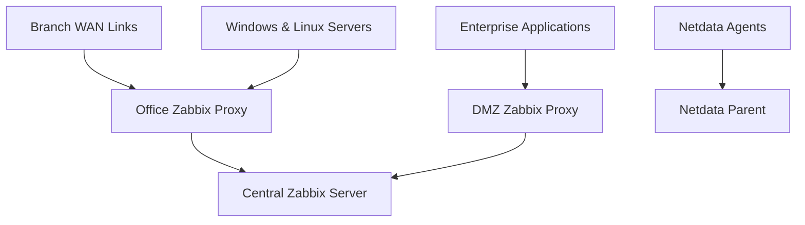

# Enterprise Infrastructure & Service Monitoring

### Zabbix | Netdata | Network Monitoring | IT Operations

## Overview

This repository documents enterprise infrastructure and service monitoring practices based on hands-on experience supporting a distributed IT environment with 1,000+ users across 31 branches.

The project focuses on infrastructure visibility, proactive alerting, service availability, performance monitoring, and efficient incident troubleshooting using Zabbix and Netdata.

The portfolio includes technical case studies covering enterprise network monitoring, Windows and Linux infrastructure, business-critical applications, distributed monitoring architecture, and operational troubleshooting.

All examples are anonymized and adapted for demonstration purposes. No production credentials, confidential configurations, or sensitive network information are intentionally included.

## Key Monitoring Areas

### 1. Network & WAN Monitoring

- Primary and backup WAN link availability
- ICMP reachability, packet loss, and response time
- Branch connectivity monitoring
- Link failure detection and alerting
- Network incident investigation

### 2. Server & Infrastructure Monitoring

- Windows and Linux server availability
- CPU, memory, and disk utilization
- Network interface traffic
- Critical operating system services
- Distributed monitoring using Zabbix Proxies
- Performance visibility using Netdata

### 3. Application & Service Monitoring

- HTTP/HTTPS service availability
- Web response time monitoring
- Windows service and process monitoring
- Jira and Tomcat monitoring
- SharePoint, IIS, and SQL Server dependencies
- Nextcloud, Redis, MariaDB, and background jobs
- TLS certificate expiration monitoring

### 4. Alerting & Incident Response

- Zabbix items, triggers, and event severity
- Operational dashboards
- Alert notification workflows
- Incident identification and troubleshooting
- Root-cause investigation
- Technical documentation and runbooks

## Technologies

| Category | Technologies |
|---|---|
| Monitoring | Zabbix 7.4, Netdata |
| Operating Systems | Windows Server, Debian Linux |
| Networking | TCP/IP, ICMP, LAN/WAN, VPN, IPsec |
| Infrastructure Automation | Ansible |
| Web & Application Services | Jira, Tomcat, SharePoint, IIS, Nextcloud |
| Databases | Microsoft SQL Server, MariaDB, MySQL |
| Additional Components | Redis, GitLab, Active Directory |

## Technical Case Studies

### Monitoring Architecture & Infrastructure

| Case Study | Technical Focus |
|---|---|
| [Enterprise Monitoring Architecture](docs/architecture.md) | Central Zabbix Server, proxies, Netdata, monitoring design |
| [Zabbix Proxy Deployment](docs/zabbix-proxy-deployment.md) | Active proxies, Debian 12, Office and DMZ |
| [Netdata Parent-Agent Monitoring](docs/netdata-parent-agent-monitoring.md) | Centralized performance metrics and streaming |
| [Monitoring Dashboards & Alerting](docs/monitoring-dashboards-alerting.md) | Dashboards, alert severity, service health |

### Network & WAN Monitoring

| Case Study | Technical Focus |
|---|---|
| [Branch WAN Monitoring](docs/branch-wan-monitoring.md) | Dual WAN links, ICMP checks, packet loss, latency and failure detection |

### Enterprise Application Monitoring

| Case Study | Technical Focus |
|---|---|
| [Jira & Tomcat Monitoring](docs/jira-tomcat-monitoring.md) | Application availability, services, performance and TLS |
| [Jira Zabbix Configuration](docs/jira-zabbix-configuration.md) | Items, triggers, web scenarios and troubleshooting |
| [SharePoint Portal Monitoring](docs/sharepoint-portal-monitoring.md) | IIS, authenticated web monitoring and SQL dependencies |
| [SharePoint Zabbix Configuration](docs/sharepoint-zabbix-configuration.md) | NTLM, IIS health, SQL monitoring and performance investigation |
| [Nextcloud Service Monitoring](docs/nextcloud-service-monitoring.md) | Application health and infrastructure dependencies |
| [Nextcloud Zabbix Configuration](docs/nextcloud-zabbix-configuration.md) | Redis, MariaDB, cron and LDAP monitoring design |

### IT Operations & Incident Management

| Case Study | Technical Focus |
|---|---|
| [Incident Response Runbooks](docs/incident-response-runbooks.md) | WAN outages, Jira, SharePoint, Nextcloud and proxy troubleshooting |

### Project Documentation

- [Technical Project Index](docs/monitoring-project-index.md)

The case studies distinguish previously implemented monitoring activities from proposed improvements and future lab validation.

## Zabbix Configuration Examples

### Dual WAN Monitoring Template

[View Zabbix 7.4 Dual WAN Template](template_wan_dual_link_zabbix74.yaml)

The sample template includes:

- Primary WAN ICMP availability
- Backup WAN ICMP availability
- Primary and backup packet loss
- Primary and backup network latency
- Primary WAN failure alert
- Backup WAN failure alert
- Simultaneous WAN failure alert

The template uses documentation-only IP addresses and host macros for reusability.

**Validation status:** The YAML file is an example configuration. Import, trigger behavior, and operational compatibility have not yet been validated in a dedicated Zabbix lab.

## Monitoring Architecture

The monitoring design uses a centralized Zabbix platform with distributed proxies to collect data from different infrastructure segments.

This is a simplified conceptual diagram. It does not represent a production network topology or disclose internal infrastructure details.

Detailed architecture documentation is available in:

- [Enterprise Monitoring Architecture](docs/architecture.md)
- [Zabbix Proxy Deployment](docs/zabbix-proxy-deployment.md)
- [Netdata Parent-Agent Monitoring](docs/netdata-parent-agent-monitoring.md)

## Project Roadmap

### Documentation — Completed

- [x] Document enterprise monitoring architecture
- [x] Document branch WAN monitoring design
- [x] Add initial Zabbix 7.4 dual WAN template example
- [x] Document Office and DMZ Zabbix Proxy deployments
- [x] Document Jira and Tomcat monitoring
- [x] Document detailed Jira Zabbix configuration
- [x] Document SharePoint, IIS and SQL monitoring
- [x] Document detailed SharePoint monitoring configuration
- [x] Document Nextcloud monitoring
- [x] Document detailed Nextcloud monitoring configuration
- [x] Document Netdata Parent-Agent architecture
- [x] Document monitoring dashboards and alerting design
- [x] Add incident response runbooks
- [x] Build technical project index

### Future Enhancements

- [ ] Add additional reusable Zabbix templates
- [ ] Add detailed alert escalation workflows
- [ ] Create sanitized monitoring dashboard examples
- [ ] Add GitLab performance monitoring configuration examples
- [ ] Expand technical troubleshooting documentation
- [ ] Add lab-validated configuration files

### Lab Validation — Pending

- [ ] Prepare an isolated monitoring lab
- [ ] Install and configure Zabbix components
- [ ] Import and validate Zabbix templates
- [ ] Verify monitoring items and triggers
- [ ] Simulate WAN connectivity failures
- [ ] Simulate application service failures
- [ ] Validate Zabbix Proxy communication
- [ ] Validate Netdata metrics streaming
- [ ] Test alert notification workflows
- [ ] Capture sanitized screenshots and test results

## Security & Confidentiality

This repository is intended for technical demonstration and professional portfolio purposes.

All examples use anonymized or illustrative information.

Before publishing additional configuration files or screenshots:

- Remove internal IP addresses and hostnames.
- Exclude credentials, API keys and authentication secrets.
- Remove customer and company-confidential information.
- Use documentation-only addresses where appropriate.
- Validate configuration examples in an isolated environment.

## About

This portfolio showcases experience in IT Infrastructure Engineering, enterprise monitoring, network operations, application availability, infrastructure troubleshooting, and service reliability.

The project combines practical operational experience with technical documentation and reusable monitoring examples.

Future updates will include lab-tested configurations, monitoring dashboards, troubleshooting evidence, and additional automation examples.
