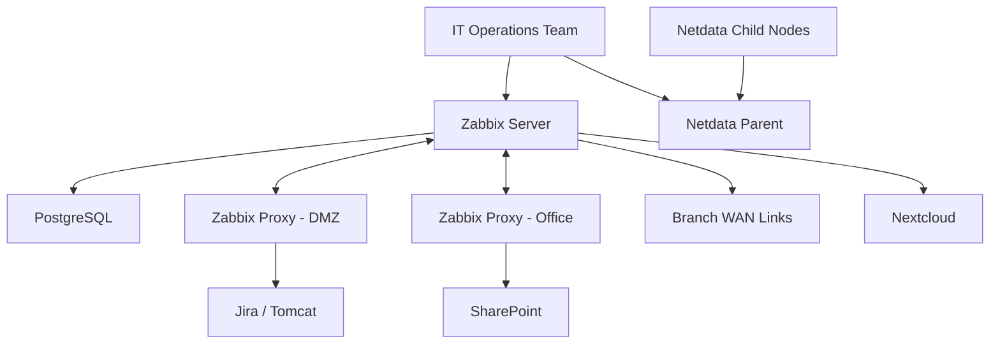

# Enterprise Infrastructure & Service Monitoring

### Zabbix | Netdata | Network Monitoring | IT Operations

## Overview

This repository presents enterprise infrastructure and service monitoring practices based on hands-on experience supporting an IT environment with more than 1,000 users across 31 branch offices.

The project focuses on monitoring enterprise systems, network connectivity, application availability, service performance, alerting, and incident response.

It combines operational experience, technical architecture documentation, monitoring configuration examples, and troubleshooting procedures.

## Technology Stack

| Technology | Purpose |
|---|---|
| Zabbix | Infrastructure and service monitoring |
| Zabbix Proxy | Distributed monitoring |
| Netdata | Real-time system performance monitoring |
| Debian Linux | Monitoring server operating system |
| PostgreSQL | Zabbix database |
| Nginx | Zabbix web frontend |
| Windows Server | Enterprise system monitoring |
| Jira / Tomcat | Application availability monitoring |
| SharePoint / IIS | Enterprise portal monitoring |
| Nextcloud | Collaboration platform monitoring |
| Cisco Networking | Network and WAN connectivity |

## Monitoring Architecture

The monitoring architecture covers centralized and distributed monitoring components.

The diagram illustrates a logical monitoring architecture. Individual monitoring paths depend on host placement, proxy assignment, and connectivity.

For more details:

[Monitoring Architecture](docs/architecture.md)

## Key Monitoring Areas

### 1. Enterprise Network & WAN Monitoring

Monitoring primary and backup WAN connectivity across branch offices.

Key monitoring capabilities:

- ICMP availability checks
- Primary and backup link monitoring
- Packet loss and response time
- Outage detection
- Link availability dashboards
- Automated notifications
- Incident investigation

Documentation:

[Branch WAN Monitoring](docs/branch-wan-monitoring.md)

### 2. Jira & Tomcat Monitoring

Monitoring application availability and supporting infrastructure.

Key metrics and checks:

- Jira service availability
- Tomcat process and service status
- HTTP availability and response time
- CPU and memory utilization
- Network traffic
- Disk utilization
- Application troubleshooting

Documentation:

- [Jira & Tomcat Monitoring](docs/jira-tomcat-monitoring.md)
- [Jira Zabbix Configuration](docs/jira-zabbix-configuration.md)

### 3. SharePoint Monitoring

Monitoring enterprise portal availability and related services.

Monitoring areas:

- Portal HTTP availability
- IIS service health
- Windows Server resource utilization
- Application response time
- Supporting service dependencies
- Performance and availability troubleshooting

Documentation:

- [SharePoint Portal Monitoring](docs/sharepoint-portal-monitoring.md)
- [SharePoint Zabbix Configuration](docs/sharepoint-zabbix-configuration.md)

### 4. Nextcloud Monitoring

Monitoring a collaboration and file-sharing platform.

Monitoring areas:

- HTTPS endpoint availability
- Apache service health
- PHP application environment
- Database availability
- CPU, memory, and storage usage
- Service troubleshooting

Documentation:

- [Nextcloud Service Monitoring](docs/nextcloud-service-monitoring.md)
- [Nextcloud Zabbix Configuration](docs/nextcloud-zabbix-configuration.md)

### 5. Netdata Performance Monitoring

Using Netdata for infrastructure performance visibility.

Key areas:

- Centralized metrics streaming
- Parent and child node architecture
- Real-time system metrics
- CPU and memory monitoring
- Disk I/O and network utilization
- System performance investigation

Documentation:

[Netdata Parent-Agent Monitoring](docs/netdata-parent-agent-monitoring.md)

### 6. Distributed Monitoring with Zabbix Proxy

Zabbix Proxy supports distributed collection and communication between monitored environments and the central Zabbix Server.

Technical areas:

- Proxy architecture
- Active and passive communication concepts
- Encrypted communication
- Monitoring host assignment
- Connectivity troubleshooting
- Proxy health and operational checks

Documentation:

[Zabbix Proxy Deployment](docs/zabbix-proxy-deployment.md)

## Dashboards, Alerting & Incident Response

The operational monitoring workflow includes:

1. Collect infrastructure and application metrics.
2. Evaluate configured trigger conditions.
3. Detect availability and performance issues.
4. Generate monitoring events and notifications.
5. Investigate incidents and service dependencies.
6. Verify recovery and document findings.

Related documentation:

- [Monitoring Dashboards & Alerting](docs/monitoring-dashboards-alerting.md)
- [Incident Response Runbooks](docs/incident-response-runbooks.md)

## Monitoring Documentation

| Document | Description |
|---|---|
| [Architecture](docs/architecture.md) | Monitoring platform architecture |
| [Branch WAN Monitoring](docs/branch-wan-monitoring.md) | Primary and backup WAN connectivity |
| [Jira & Tomcat](docs/jira-tomcat-monitoring.md) | Application and service monitoring |
| [Jira Configuration](docs/jira-zabbix-configuration.md) | Zabbix configuration examples |
| [SharePoint Monitoring](docs/sharepoint-portal-monitoring.md) | Enterprise portal availability |
| [SharePoint Configuration](docs/sharepoint-zabbix-configuration.md) | Zabbix monitoring examples |
| [Nextcloud Monitoring](docs/nextcloud-service-monitoring.md) | Collaboration service monitoring |
| [Nextcloud Configuration](docs/nextcloud-zabbix-configuration.md) | Zabbix monitoring examples |
| [Netdata Monitoring](docs/netdata-parent-agent-monitoring.md) | Centralized metrics streaming |
| [Zabbix Proxy](docs/zabbix-proxy-deployment.md) | Distributed monitoring architecture |
| [Dashboards & Alerting](docs/monitoring-dashboards-alerting.md) | Dashboards, triggers, and alerts |
| [Incident Runbooks](docs/incident-response-runbooks.md) | Incident investigation procedures |
| [Documentation Index](docs/monitoring-project-index.md) | Technical documentation navigation |

## Configuration Examples

### Branch WAN Monitoring

The repository includes a Zabbix template example for monitoring primary and backup branch connectivity.

[View WAN Monitoring Template](template_wan_dual_link_zabbix74.yaml)

The template provides a reusable configuration reference for WAN availability monitoring.

Configuration examples should be reviewed and adapted to the target Zabbix version and environment before operational use.

## Operational Best Practices

- Establish clear monitoring ownership.
- Prioritize business-critical services.
- Monitor both infrastructure and application availability.
- Define meaningful triggers and severity levels.
- Reduce unnecessary alert noise.
- Document service dependencies.
- Maintain incident response procedures.
- Review monitoring coverage regularly.
- Protect monitoring credentials and sensitive information.

## Security & Confidentiality

Documentation and reusable configuration examples use anonymized infrastructure information.

Production credentials, authentication tokens, confidential network configurations, and sensitive organizational information are excluded from the public repository.

## Professional Context

This portfolio builds on enterprise IT infrastructure operations experience involving:

- More than 1,000 users
- 31 branch offices
- Enterprise Windows and Linux systems
- Network and WAN infrastructure
- Business-critical application services
- Monitoring, troubleshooting, and incident response

The objective is to demonstrate infrastructure monitoring design, operational knowledge, and technical documentation practices relevant to IT Infrastructure Engineering, Systems Administration, and Monitoring Engineering.

## About

A technical portfolio focused on enterprise infrastructure monitoring, service availability, network operations, Zabbix, Netdata, and operational troubleshooting.
