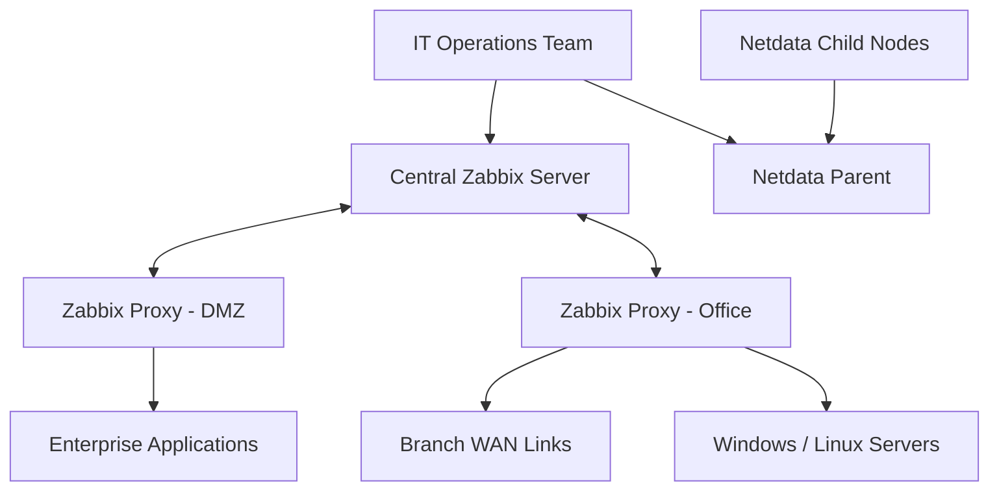
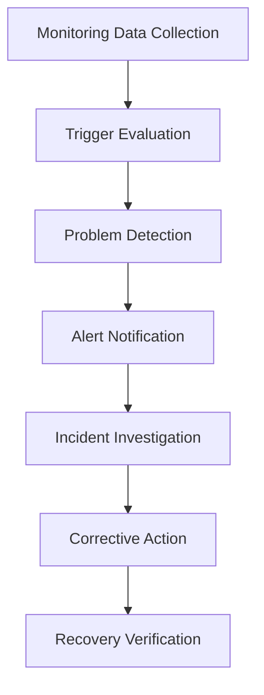

# Enterprise Monitoring Architecture

## 1. Architecture Overview

This document describes a distributed enterprise infrastructure monitoring architecture using Zabbix Server, Zabbix Proxies, and Netdata.

The architecture is based on operational experience in a multi-site IT environment supporting more than 1,000 users across 31 branch offices.

The design combines centralized monitoring management, distributed data collection, network availability monitoring, application health checks, and infrastructure performance analysis.

All hostnames, addresses, and configuration examples are illustrative and do not represent confidential production infrastructure.

## 2. Logical Architecture

This diagram illustrates a logical monitoring design.

Actual monitoring paths depend on host placement, proxy assignment, firewall policies, and network connectivity.

## 3. Monitoring Components

### Central Zabbix Server

The central Zabbix Server provides:

- Centralized monitoring configuration
- Host and template management
- Item and trigger processing
- Event detection
- Alerting and notification management
- Dashboards and operational reporting
- Monitoring data collection and analysis

A typical deployment includes a database backend and web frontend.

### Zabbix Proxies

Zabbix Proxies enable distributed monitoring across different network segments.

Key responsibilities:

- Collect monitoring data from assigned hosts
- Communicate with the central Zabbix Server
- Reduce direct monitoring access requirements across segmented networks
- Buffer collected data during temporary communication interruptions
- Support distributed infrastructure monitoring

Proxy placement should consider network segmentation, connectivity, authentication, and resource requirements.

### Network Monitoring

Network monitoring focuses on branch connectivity and WAN availability.

Key monitoring areas:

- Primary WAN link availability
- Backup WAN link availability
- ICMP reachability
- Packet loss
- Network latency
- Link failure detection
- Branch connectivity alerts

Primary and backup connection monitoring supports faster identification of communication failures affecting remote offices.

### Server Monitoring

Infrastructure monitoring covers Windows and Linux systems.

Typical metrics include:

- CPU utilization
- Memory consumption
- Disk capacity
- Disk I/O
- Network interface traffic
- Windows service status
- Linux process availability
- Host availability and performance

Monitoring templates help standardize collection and alerting across multiple systems.

### Application Monitoring

Application monitoring provides visibility into critical enterprise services.

Examples include:

- Jira / Tomcat
- SharePoint / IIS
- Nextcloud

Monitoring areas:

- HTTP and HTTPS availability
- Application response time
- Supporting service health
- CPU and memory utilization
- Disk capacity and performance
- Application availability incidents

Application monitoring should account for dependencies between the application, operating system, database, and network infrastructure.

### Netdata Monitoring

Netdata provides detailed infrastructure performance metrics.

A Parent-Child architecture supports centralized metric collection and visualization.

Monitoring capabilities include:

- CPU and memory utilization
- Disk I/O
- Network traffic
- System performance metrics
- Real-time resource analysis
- Performance troubleshooting

Netdata complements Zabbix by providing detailed system metrics and performance visibility.

## 4. Monitoring Data Flow

A typical monitoring workflow includes:

1. Collect metrics from monitored hosts and services.
2. Forward distributed monitoring data through assigned Zabbix Proxies.
3. Process collected values at the central Zabbix Server.
4. Evaluate configured trigger expressions.
5. Generate monitoring events when trigger conditions are met.
6. Deliver notifications according to configured alerting rules.
7. Investigate incidents using monitoring data and operational dashboards.
8. Verify service recovery and document findings.

The exact workflow depends on the monitoring item type, proxy configuration, and alerting design.

## 5. Architecture Design Considerations

### Network Segmentation

Proxy deployment should align with network security boundaries and permitted communication paths.

### Secure Communication

Monitoring communication should use appropriate encryption, authentication, and firewall controls.

### Scalability

Templates, host groups, and distributed collection improve consistency across a multi-site environment.

### Alerting

Trigger thresholds and severity levels should reflect infrastructure criticality and operational requirements.

### Service Dependencies

Monitoring should distinguish infrastructure failures from dependent application symptoms where possible.

### Operational Documentation

Monitoring configurations, dashboards, alerts, and incident response procedures should be documented and maintained.

## 6. Monitoring and Incident Response

The monitoring architecture supports a structured operational response:

Incident investigation may involve:

- Reviewing Zabbix problem events
- Inspecting historical metrics
- Comparing current and baseline performance
- Checking connectivity and service dependencies
- Reviewing operating system and application logs
- Verifying recovery after corrective actions

## 7. Security Considerations

- Restrict access to monitoring dashboards.
- Apply least-privilege permissions.
- Protect monitoring credentials and API tokens.
- Encrypt monitoring communication where appropriate.
- Restrict network access between monitoring components.
- Avoid exposing confidential hostnames and network addresses.
- Review alert notification destinations.
- Maintain appropriate access and change management procedures.

## 8. Operational Verification Checklist

### Zabbix Server

- [ ] Verify server service availability
- [ ] Verify database connectivity
- [ ] Verify frontend availability
- [ ] Inspect monitoring queue and data collection

### Zabbix Proxies

- [ ] Verify proxy connectivity
- [ ] Inspect proxy data collection
- [ ] Review proxy synchronization
- [ ] Verify assigned hosts

### Network Monitoring

- [ ] Verify primary link monitoring
- [ ] Verify backup link monitoring
- [ ] Review latency and packet loss
- [ ] Inspect branch connectivity alerts

### Application Monitoring

- [ ] Verify service availability checks
- [ ] Inspect application response times
- [ ] Review supporting service metrics
- [ ] Validate alert conditions

### Netdata

- [ ] Verify Parent-Child streaming configuration
- [ ] Review resource metrics
- [ ] Inspect network and storage performance
- [ ] Confirm metric availability

## 9. Related Documentation

- [Branch WAN Monitoring](branch-wan-monitoring.md)
- [Zabbix Proxy Deployment](zabbix-proxy-deployment.md)
- [Jira & Tomcat Monitoring](jira-tomcat-monitoring.md)
- [SharePoint Monitoring](sharepoint-portal-monitoring.md)
- [Nextcloud Monitoring](nextcloud-service-monitoring.md)
- [Netdata Parent-Agent Monitoring](netdata-parent-agent-monitoring.md)
- [Monitoring Dashboards & Alerting](monitoring-dashboards-alerting.md)
- [Incident Response Runbooks](incident-response-runbooks.md)

## 10. References

- [Zabbix Documentation](https://www.zabbix.com/documentation/current/)
- [Netdata Documentation](https://learn.netdata.cloud/)
