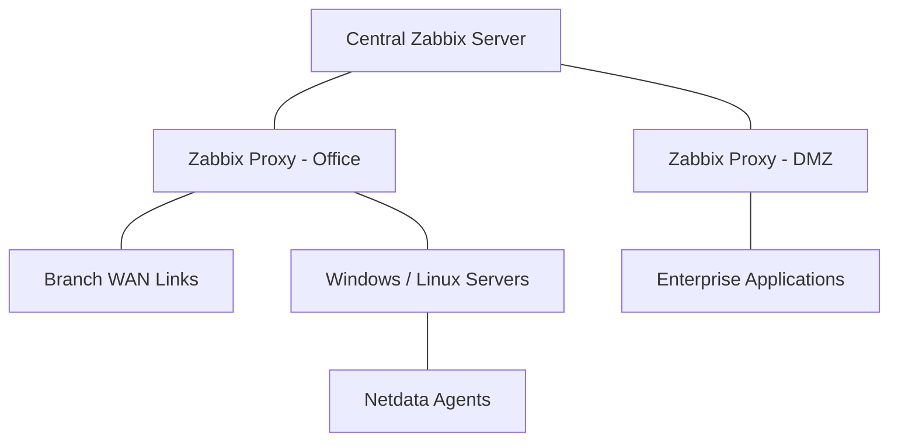

# Enterprise Monitoring Architecture

## 1. Architecture Overview

This project demonstrates a distributed enterprise monitoring architecture using Zabbix Server, Zabbix Proxies, and Netdata.

The design is based on operational experience in a multi-site environment supporting 1,000+ users across 31 branches.

All hostnames, addresses, and configurations used in this repository are illustrative and do not represent production systems.

## 2. Architecture Diagram

## 3. Monitoring Components

### Central Zabbix Server
- Centralized configuration and monitoring
- Alerting and event correlation
- Dashboards and operational reporting

### Zabbix Proxies
- Distributed metric collection
- Monitoring across network segments
- Forwarding collected data to the central server

### Network Monitoring
- Primary and backup WAN availability
- Packet loss and latency
- Branch connectivity alerts

### Server Monitoring
- CPU, memory and disk utilization
- Network traffic
- Windows services and Linux processes

### Application Monitoring
- HTTP/HTTPS availability
- Response time
- Jira, SharePoint and Nextcloud service health

### Netdata
- Detailed performance metrics
- Real-time server and application visibility

## 4. Design Considerations

- Network segmentation and proxy placement
- Secure communication between monitoring components
- Alert severity and escalation
- Scalability across multiple sites
- Standardized monitoring templates
- Operational documentation

## 5. Planned Improvements

- Document Zabbix proxy deployment
- Add sample monitoring templates
- Document WAN failover monitoring
- Add incident response runbooks
- Include sanitized lab screenshots
