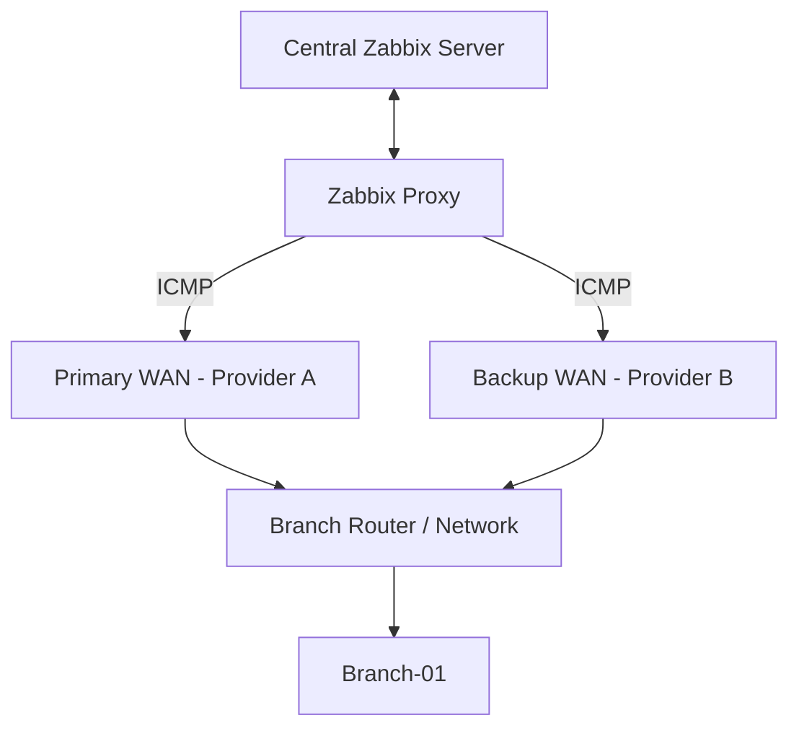
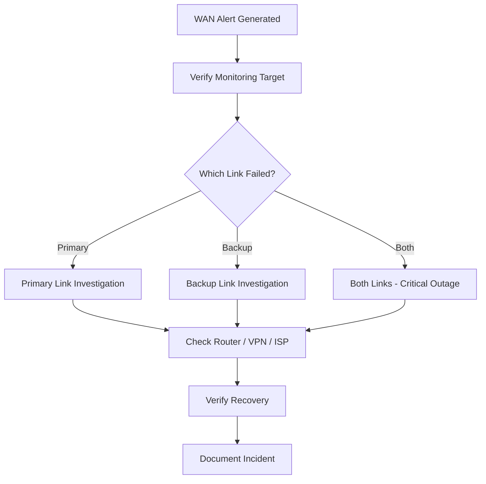

# Branch WAN Monitoring with Zabbix

## 1. Overview

This document describes a dual-link WAN monitoring approach for enterprise branch offices using Zabbix.

The monitoring design covers primary and backup connections, link availability, latency, packet loss, alerting, and incident investigation.

The architecture is informed by operational experience with multi-branch enterprise network infrastructure.

## 2. Monitoring Objectives

- Detect primary WAN failures
- Detect backup WAN failures
- Identify simultaneous loss of both connections
- Monitor packet loss and latency
- Generate meaningful operational alerts
- Support WAN troubleshooting and incident response
- Provide centralized branch connectivity visibility

## 3. Reference Network Configuration

Example branch: `Branch-01`

| Connection | Provider | Monitoring IP |
|---|---|---|
| Primary WAN | Provider-A | 192.0.2.10 |
| Backup WAN | Provider-B | 198.51.100.10 |

The addresses are reserved documentation examples.

The Zabbix Server or assigned Proxy must have IP connectivity to the monitored targets.

## 4. Logical Monitoring Architecture



The diagram represents logical monitoring targets and WAN connections rather than an exact physical topology.

## 5. Host-Level Macros

Define the following macros for each monitored branch:

| Macro | Example Value |
|---|---|
| `{$PRIMARY_LINK_IP}` | 192.0.2.10 |
| `{$BACKUP_LINK_IP}` | 198.51.100.10 |
| `{$PRIMARY_PROVIDER}` | Provider-A |
| `{$BACKUP_PROVIDER}` | Provider-B |

Using host-level macros allows a common template to be applied to multiple branches.

Each branch can maintain its own provider information and monitoring addresses.

## 6. Zabbix Monitoring Items

The following items use Zabbix ICMP simple checks.

### Primary WAN Availability

Name: `Primary WAN - ICMP Availability`

Key:

`icmpping[{$PRIMARY_LINK_IP}]`

Type: Simple check

Type of information: Numeric (unsigned)

Update interval: `1m`

### Backup WAN Availability

Name: `Backup WAN - ICMP Availability`

Key:

`icmpping[{$BACKUP_LINK_IP}]`

Type: Simple check

Type of information: Numeric (unsigned)

Update interval: `1m`

### Primary WAN Packet Loss

Key:

`icmppingloss[{$PRIMARY_LINK_IP}]`

Units: `%`

### Backup WAN Packet Loss

Key:

`icmppingloss[{$BACKUP_LINK_IP}]`

Units: `%`

### Primary WAN Response Time

Key:

`icmppingsec[{$PRIMARY_LINK_IP}]`

Units: `s`

### Backup WAN Response Time

Key:

`icmppingsec[{$BACKUP_LINK_IP}]`

Units: `s`

Packet loss and response time metrics can support investigation of degraded WAN connectivity.

## 7. Trigger Configuration

Reference template:

`Template WAN Dual Link`

### Primary WAN Down

Severity: High

```text
max(/Template WAN Dual Link/icmpping[{$PRIMARY_LINK_IP}],#3)=0
```

The condition is met when the last three availability values are all zero.

### Backup WAN Down

Severity: Warning

```text
max(/Template WAN Dual Link/icmpping[{$BACKUP_LINK_IP}],#3)=0
```

### Both WAN Links Down

Severity: Disaster

```text
max(/Template WAN Dual Link/icmpping[{$PRIMARY_LINK_IP}],#3)=0
and
max(/Template WAN Dual Link/icmpping[{$BACKUP_LINK_IP}],#3)=0
```

The combined expression detects loss of both monitored targets.

The `and` operator must be part of the same trigger expression when configured in Zabbix.

### Alert Correlation

Trigger dependencies can reduce duplicate problem notifications.

For example, individual link-down triggers may depend on the combined branch outage trigger, depending on the intended event and escalation behavior.

## 8. Monitoring Dashboard

A branch connectivity dashboard can include:

- Branch name and location
- Primary WAN status
- Backup WAN status
- Provider information
- Packet loss
- Response time
- Active monitoring problems
- Recent connectivity events

A consolidated dashboard supports operational visibility across multiple branch offices.

## 9. Incident Response Workflow



### Investigation Steps

1. Review the Zabbix event and affected branch.
2. Confirm monitoring connectivity from the assigned Proxy.
3. Identify the failed WAN connection.
4. Inspect router interfaces and routing status.
5. Review VPN or tunnel connectivity.
6. Check local provider equipment and link status.
7. Escalate to the appropriate network provider when necessary.
8. Verify recovery through monitoring data.
9. Document the incident and corrective action.

## 10. Operational Considerations

### Monitoring Target Selection

Monitoring targets should accurately represent the intended WAN path.

ICMP reachability to an arbitrary remote address may not reliably identify which provider or tunnel has failed.

### Proxy Placement

The monitoring origin determines the network path used for checks.

Proxy placement and routing must be considered when monitoring different WAN connections.

### ICMP Collection

Zabbix ICMP simple checks require appropriate `fping` configuration on the collecting server or proxy.

### Application Availability

Successful ICMP checks do not guarantee that applications are reachable or functioning correctly.

Application-level monitoring should complement WAN availability checks.

### Alert Thresholds

Trigger thresholds should account for expected network behavior, transient packet loss, and operational priorities.

### Recovery Verification

Recovery should be confirmed using current monitoring values and, where appropriate, application connectivity tests.

## 11. Operational Verification Checklist

### Monitoring Configuration

- [ ] Verify host macros
- [ ] Verify primary monitoring IP
- [ ] Verify backup monitoring IP
- [ ] Verify Zabbix Proxy assignment
- [ ] Check ICMP item availability

### Trigger Logic

- [ ] Verify primary-down expression
- [ ] Verify backup-down expression
- [ ] Verify combined outage expression
- [ ] Review trigger severities
- [ ] Review trigger dependencies

### Dashboards and Alerting

- [ ] Confirm branch status visibility
- [ ] Review packet loss and latency graphs
- [ ] Verify event notification rules
- [ ] Confirm escalation responsibilities

### Incident Response

- [ ] Confirm failure detection
- [ ] Investigate WAN routing and tunnel status
- [ ] Verify recovery
- [ ] Record incident findings

## 12. Related Documentation

- [Monitoring Architecture](architecture.md)
- [Monitoring Dashboards and Alerting](monitoring-dashboards-alerting.md)
- [Incident Response Runbooks](incident-response-runbooks.md)
- [Zabbix Proxy Deployment](zabbix-proxy-deployment.md)

## 13. References

- [Zabbix Documentation](https://www.zabbix.com/documentation/current/)
- [Zabbix Simple Checks](https://www.zabbix.com/documentation/current/en/manual/config/items/itemtypes/simple_checks)
- [Zabbix Trigger Functions](https://www.zabbix.com/documentation/current/en/manual/appendix/functions)
