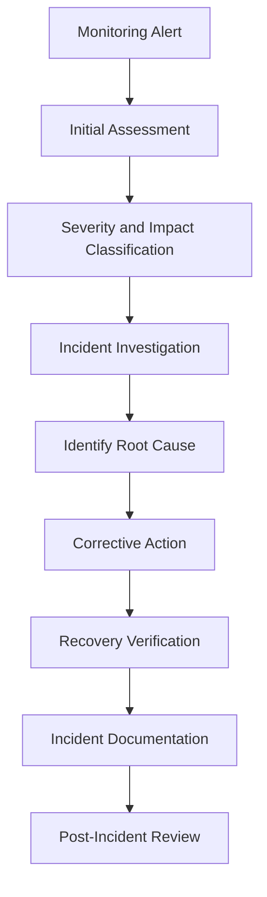

# Enterprise IT Incident Response Runbooks

## 1. Overview

This document provides structured incident investigation and recovery procedures for enterprise infrastructure, network connectivity, monitoring systems, and business-critical applications.

The scenarios are based on practical infrastructure operations and troubleshooting experience in a distributed enterprise environment.

The runbooks cover:

- Branch WAN connectivity failures
- Jira and Tomcat service incidents
- SharePoint portal availability
- Nextcloud service degradation
- Zabbix Proxy communication failures
- Incident documentation and post-incident review

All infrastructure examples are anonymized.

## 2. Incident Response Lifecycle



### General Response Principles

1. Confirm the alert and affected service.
2. Determine operational and business impact.
3. Identify the affected infrastructure components.
4. Review monitoring data and supporting logs.
5. Investigate dependencies before applying corrective actions.
6. Follow approved operational and change procedures.
7. Verify recovery through monitoring and functional checks.
8. Document findings and preventive recommendations.

## 3. Runbook — Branch WAN Connectivity Failure

### Symptoms

- Primary WAN unavailable
- Backup WAN unavailable
- Increased ICMP packet loss
- High network latency
- VPN or tunnel connectivity failure
- Branch users unable to access corporate services

### Investigation Procedure

1. Identify the affected branch.
2. Review the Zabbix problem event.
3. Check the primary WAN status.
4. Check the backup WAN status.
5. Verify ICMP connectivity from the assigned Zabbix Proxy.
6. Review router interface status.
7. Inspect routing information.
8. Check VPN or tunnel connectivity.
9. Determine whether the issue affects one provider or both.
10. Escalate provider-side failures when necessary.

### Example Network Commands

Cisco IOS / IOS XE:

```text
show ip interface brief
show interfaces
show ip route
show ip sla statistics
show track
```

For relevant tunnel configurations:

```text
show interfaces tunnel
show running-config interface Tunnel0
```

Replace `Tunnel0` with the appropriate interface name.

### Recovery Verification

- Confirm primary or backup connectivity.
- Verify routing to required corporate services.
- Review Zabbix ICMP metrics.
- Check packet loss and response time.
- Confirm branch application accessibility.
- Document the incident.

### Escalation

| Condition | Severity |
|---|---|
| Primary WAN unavailable | High |
| Backup WAN unavailable | Warning |
| Both WAN links unavailable | Disaster |

Severity should reflect actual operational impact.

## 4. Runbook — Jira / Tomcat Service Unavailable

### Symptoms

- Jira web interface inaccessible
- HTTPS monitoring failure
- Jira Windows service stopped
- Tomcat process unavailable
- Elevated response time
- Application errors

### Investigation Procedure

1. Verify server network connectivity.
2. Check Jira HTTPS availability.
3. Review Zabbix web scenario results.
4. Inspect the Jira Windows service.
5. Check Tomcat process availability.
6. Review CPU and memory utilization.
7. Check disk capacity.
8. Inspect Windows and application logs.
9. Review database availability.
10. Determine the most likely failure source.

### Windows Service Investigation

Example PowerShell:

```powershell
Get-Service | Where-Object {
    $_.DisplayName -match "Jira|Tomcat"
}
```

Review relevant processes:

```powershell
Get-Process | Where-Object {
    $_.ProcessName -match "java|tomcat"
}
```

### Recovery

- Resolve identified infrastructure or service issues.
- Coordinate service restarts through approved procedures.
- Verify Jira HTTPS availability.
- Confirm user-facing application functionality.
- Review monitoring metrics after recovery.

### Escalation

Escalate application-specific issues to the application team and database-related failures to the appropriate database administrators.

## 5. Runbook — SharePoint Portal Unavailable

### Symptoms

- Portal inaccessible
- HTTP/HTTPS failure
- NTLM authentication errors
- IIS-related service failure
- Elevated response time
- SQL Server connectivity problems

### Investigation Procedure

1. Check SharePoint server availability.
2. Review the Zabbix web scenario.
3. Confirm expected HTTP response codes.
4. Investigate authentication behavior.
5. Review IIS-related services.
6. Inspect application pools where appropriate.
7. Check Windows Server resources.
8. Review SQL Server availability.
9. Inspect relevant Windows and application logs.
10. Determine whether the incident originates from IIS, SharePoint, SQL Server, or infrastructure.

### Example PowerShell Commands

Check IIS service:

```powershell
Get-Service W3SVC
```

Review IIS application pools using WebAdministration:

```powershell
Import-Module WebAdministration
Get-ChildItem IIS:\AppPools
```

Review SQL-related Windows services:

```powershell
Get-Service | Where-Object {
    $_.Name -match "MSSQL|SQL"
}
```

### Recovery Verification

- Confirm portal accessibility.
- Verify authentication.
- Review response time.
- Confirm IIS service health.
- Verify SQL Server connectivity.
- Confirm Zabbix alerts have recovered.

### Escalation

Escalate to SharePoint, Windows Server, IIS, or SQL Server specialists according to the affected component.

## 6. Runbook — Nextcloud Service Degradation

### Symptoms

- Nextcloud inaccessible
- Slow HTTPS response
- Login failures
- Database connectivity errors
- Redis failures
- Background job delays
- Filesystem capacity problems

### Investigation Procedure

1. Verify Linux host connectivity.
2. Check the HTTPS endpoint.
3. Review the Nextcloud status endpoint.
4. Inspect Apache service health.
5. Review PHP-related errors.
6. Check MariaDB service availability.
7. Inspect Redis connectivity.
8. Review filesystem capacity.
9. Examine background job execution.
10. Investigate Active Directory / LDAP dependencies when authentication is affected.

### Example Linux Commands

Check services:

```bash
sudo systemctl status apache2
sudo systemctl status mariadb
sudo systemctl status redis-server
```

Inspect storage:

```bash
df -h
```

Inspect memory:

```bash
free -h
```

Review recent service logs:

```bash
sudo journalctl -u apache2 -n 100 --no-pager
```

### Application Status

Example endpoint:

```text
https://nextcloud.example.com/status.php
```

Review the application status and maintenance state.

### Recovery Verification

- Confirm HTTPS availability.
- Verify application status.
- Check user authentication.
- Confirm file access.
- Review database and Redis availability.
- Check background job processing.
- Verify monitoring recovery.

## 7. Runbook — Zabbix Proxy Communication Failure

### Symptoms

- Monitoring data becomes stale
- Multiple hosts stop reporting
- Proxy communication errors
- Proxy configuration synchronization problems
- Delayed monitoring data collection

### Investigation Procedure

1. Verify the proxy host is reachable.
2. Check Zabbix Proxy service status.
3. Review proxy logs.
4. Verify central server connectivity.
5. Inspect routing and firewall permissions.
6. Confirm proxy hostname configuration.
7. Review TLS/PSK configuration.
8. Inspect proxy database availability.
9. Check proxy resource utilization.
10. Confirm the proxy's status in the Zabbix frontend.

### Example Linux Commands

Check service:

```bash
sudo systemctl status zabbix-proxy
```

Review logs:

```bash
sudo journalctl -u zabbix-proxy -n 100 --no-pager
```

Check central server connectivity:

```bash
nc -vz zabbix.example.test 10051
```

Inspect proxy configuration:

```bash
sudo grep -E '^(Server|Hostname|TLSConnect|TLSPSKIdentity)=' /etc/zabbix/zabbix_proxy.conf
```

Avoid displaying secret values or private key material in shared diagnostic output.

### Recovery Verification

- Confirm proxy communication.
- Verify configuration synchronization.
- Check monitored host availability.
- Confirm new values appear in Latest data.
- Review buffered data and collection delays.
- Verify monitoring alerts return to the expected state.

## 8. Incident Severity and Escalation

| Severity | Description | Example |
|---|---|---|
| Information | Non-critical operational event | Informational status change |
| Warning | Early degradation | Backup WAN failure |
| Average | Service condition requiring investigation | Elevated application response time |
| High | Significant service failure | Jira application unavailable |
| Disaster | Critical business outage | Both branch WAN links unavailable |

Severity classification should consider:

- Number of affected users
- Service criticality
- Business impact
- Available redundancy
- Duration
- Recovery requirements

## 9. Incident Documentation

Each incident record should capture:

| Field | Description |
|---|---|
| Incident ID | Unique tracking identifier |
| Start Time | Detection timestamp |
| Affected Service | Application, network, or infrastructure |
| Severity | Operational and business impact |
| Symptoms | Observed alerts and errors |
| Investigation | Diagnostic steps and evidence |
| Root Cause | Confirmed cause, if identified |
| Corrective Action | Steps taken to restore service |
| Recovery Time | Confirmed restoration timestamp |
| Follow-up | Preventive recommendations |

### Example Incident Summary

```text
Incident ID: INC-EXAMPLE-001

Affected Service: Branch WAN Connectivity

Severity: High

Detection:
Primary WAN monitoring target became unreachable.

Investigation:
Reviewed Zabbix ICMP data, router interfaces,
routing information, and provider connectivity.

Corrective Action:
Followed approved network recovery procedures.

Recovery Verification:
Confirmed monitoring target reachability and
application access.

Follow-up:
Review recurring connection failures and
provider escalation procedures.
```

This is an illustrative incident record.

## 10. Post-Incident Review

After service restoration:

1. Establish the incident timeline.
2. Review monitoring events and logs.
3. Identify the confirmed root cause or unresolved factors.
4. Evaluate alert quality and detection timing.
5. Review recovery procedures.
6. Identify recurring failure patterns.
7. Assign preventive actions.
8. Update monitoring configuration and runbooks where appropriate.

## 11. Operational Best Practices

- Verify monitoring events before making changes.
- Prioritize business-critical services.
- Use historical metrics during troubleshooting.
- Correlate infrastructure and application monitoring data.
- Maintain approved recovery and escalation procedures.
- Avoid unnecessary restarts without investigation.
- Protect credentials and sensitive configuration information.
- Record technical findings and corrective actions.
- Use incident reviews to improve monitoring coverage.

## 12. Related Documentation

- [Monitoring Architecture](architecture.md)
- [Branch WAN Monitoring](branch-wan-monitoring.md)
- [Jira & Tomcat Monitoring](jira-tomcat-monitoring.md)
- [SharePoint Portal Monitoring](sharepoint-portal-monitoring.md)
- [Nextcloud Service Monitoring](nextcloud-service-monitoring.md)
- [Zabbix Proxy Deployment](zabbix-proxy-deployment.md)
- [Monitoring Dashboards and Alerting](monitoring-dashboards-alerting.md)

## 13. References

- [Zabbix Documentation](https://www.zabbix.com/documentation/current/)
- [Netdata Documentation](https://learn.netdata.cloud/)
- [Microsoft Windows Server Documentation](https://learn.microsoft.com/en-us/windows-server/)
