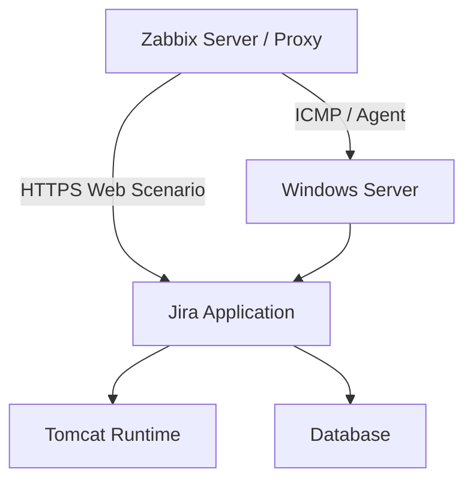
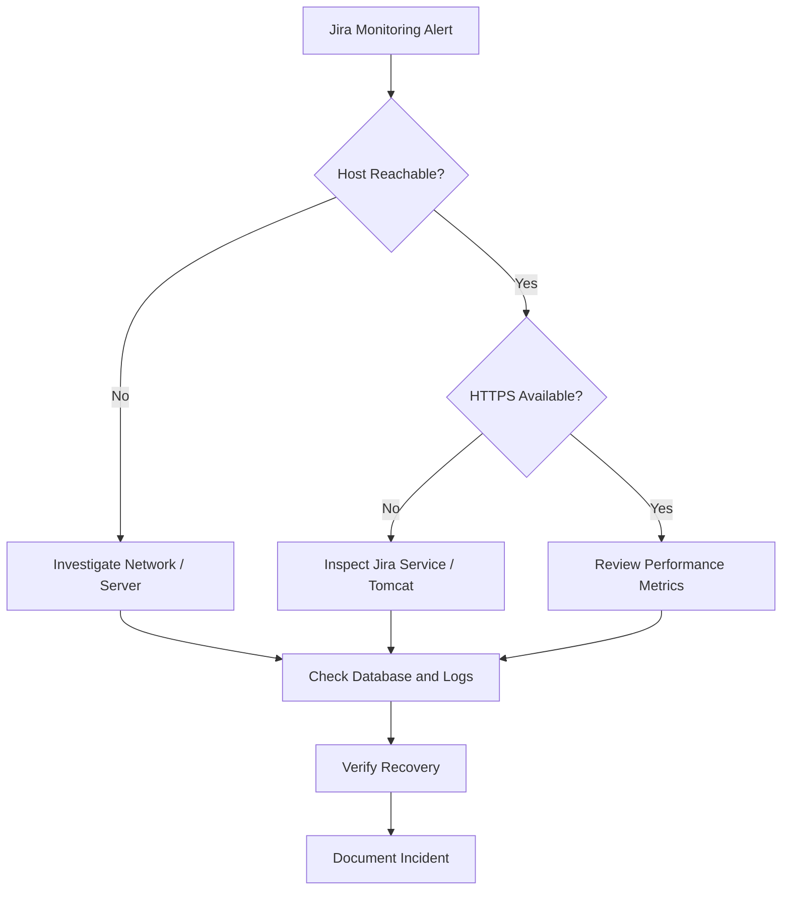

# Jira & Tomcat — Enterprise Application Monitoring

## 1. Overview

This case study documents the monitoring of a business-critical Jira application hosted on Windows Server, using Zabbix.

The monitoring approach covers network availability, Jira Windows service status, Tomcat runtime performance, HTTPS availability, TLS certificates, and infrastructure dependencies.

The documentation is based on hands-on enterprise monitoring experience, with anonymized examples suitable for public technical reference.

## 2. Monitoring Architecture



## 3. Monitoring Coverage

| Layer | Monitored Metrics | Operational Scope |
|---|---|---|
| Network | ICMP availability, packet loss, latency | Implemented |
| Web | HTTPS availability, response time, HTTP status | Implemented |
| Application | Jira Windows service state | Implemented |
| Tomcat | Process availability, CPU and memory | Implemented |
| Certificates | TLS certificate expiration | Implemented |
| Operating System | CPU, memory, disk, network traffic | Implemented |
| Database | MySQL availability | Included in monitoring scope |
| Virtualization | VMware ESXi / vCenter | Deferred during infrastructure migration |

Detailed application log parsing and JMX monitoring are outside the scope of this case study.

## 4. Jira Windows Service Monitoring

The Jira Windows service can be monitored through the Zabbix Agent.

Example item key:

```text
service.info["jira",state]
```

Example trigger:

```text
last(/JIRA/service.info["jira",state])<>0
```

`JIRA` is an illustrative Zabbix host name.

The Windows service identifier and state mapping must correspond to the monitored installation.

## 5. Tomcat Runtime Monitoring

Tomcat monitoring provides additional visibility into application runtime behavior.

Monitoring areas include:

- Process availability
- CPU utilization
- Memory consumption
- Runtime resource trends

Monitoring application processes alongside operating system resource metrics helps distinguish application-specific issues from server-wide resource pressure.

## 6. Web Availability Monitoring

Zabbix web scenarios monitor user-facing application availability.

Typical metrics include:

- HTTPS endpoint accessibility
- HTTP response status
- Response time
- Web scenario failures

Web availability monitoring complements Windows service monitoring, because a running service does not always guarantee that Jira is accessible.

## 7. TLS Certificate Monitoring

TLS certificate monitoring supports early detection of upcoming certificate expiration.

Key operational considerations:

- Certificate expiration date
- Warning thresholds
- Renewal ownership
- HTTPS availability after renewal

## 8. Operational Alert Scenarios

| Alert | Investigation Focus |
|---|---|
| Jira Windows service stopped | Service state and Windows logs |
| Tomcat process unavailable | Application runtime and process status |
| HTTPS check failed | Web endpoint and application dependencies |
| Elevated response time | Application, server and database performance |
| High Tomcat CPU or memory | Runtime resource consumption |
| Certificate expiration approaching | TLS certificate renewal |
| Database unavailable | Database service and connectivity |

Alert thresholds should reflect normal operating conditions and application requirements.

## 9. Incident Investigation Workflow



### Investigation Procedure

1. Review the Zabbix event and affected monitoring items.
2. Verify network availability.
3. Check HTTPS availability and response time.
4. Inspect Jira Windows service status.
5. Review Tomcat process and resource metrics.
6. Examine Windows Server CPU, memory, disk and network performance.
7. Check database availability and application dependencies.
8. Review application and operating system logs.
9. Verify service recovery.
10. Document the incident and corrective action.

## 10. Monitoring Design Considerations

- Distinguish server reachability from application availability.
- Monitor Jira service state independently of HTTPS availability.
- Correlate Tomcat metrics with operating system performance.
- Monitor TLS certificate expiration proactively.
- Review alert severity and escalation rules.
- Use historical performance data to establish appropriate thresholds.
- Protect monitoring credentials and sensitive application information.

## 11. Related Documentation

- [Jira Zabbix Configuration](jira-zabbix-configuration.md)
- [Monitoring Architecture](architecture.md)
- [Monitoring Dashboards and Alerting](monitoring-dashboards-alerting.md)
- [Incident Response Runbooks](incident-response-runbooks.md)

## 12. References

- [Zabbix Documentation](https://www.zabbix.com/documentation/current/)
- [Zabbix Windows Agent Monitoring](https://www.zabbix.com/documentation/current/en/manual/config/items/itemtypes/zabbix_agent/win_keys)
