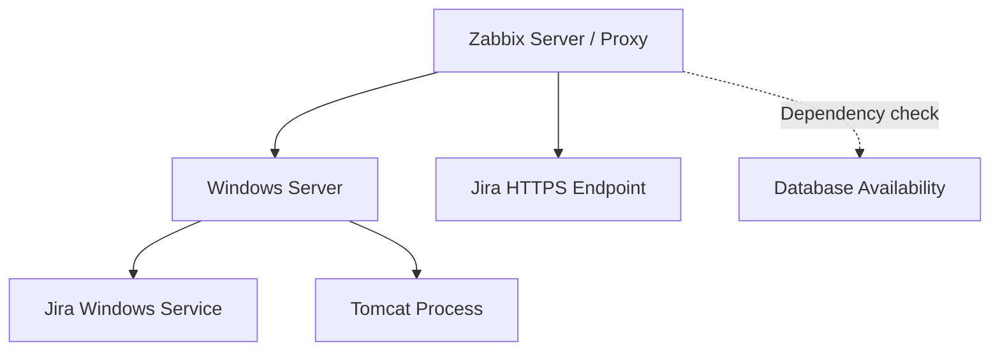
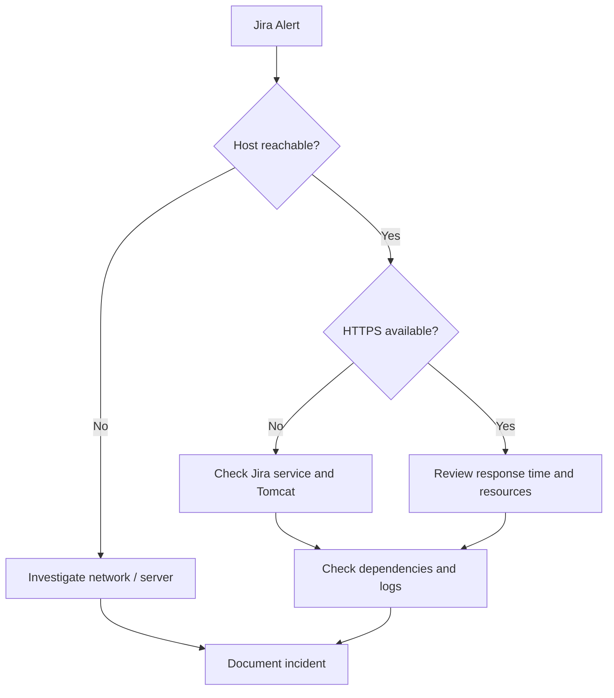

# Jira & Tomcat — Zabbix Monitoring Configuration

## 1. Objective

This document describes a layered Zabbix monitoring configuration for a Jira application running on Windows Server with a Tomcat-based runtime.

The monitoring design is based on hands-on enterprise monitoring experience. The example values and proposed thresholds require validation in a dedicated Zabbix 7.4 lab.

## 2. Monitoring Architecture

## 3. Monitoring Layers

| Layer | Metric | Method |
|---|---|---|
| Network | Reachability | ICMP |
| Network | Packet loss | ICMP |
| Network | Round-trip time | ICMP |
| Operating system | CPU / Memory | Zabbix Agent |
| Storage | Disk usage | Zabbix Agent |
| Application | Jira Windows service | Zabbix Agent |
| Runtime | Tomcat process health | Process monitoring |
| Web | HTTPS availability | Web scenario |
| Web | Response time | Web scenario |
| Security | TLS expiration | Certificate monitoring |
| Database | Availability | Database-specific check |

## 4. Example Zabbix Items

### 4.1 ICMP Availability

Type: Simple check

Key:

`icmpping`

Interval: 1m

Expected result:
- 1 = reachable
- 0 = unreachable

### 4.2 Jira Windows Service

Type: Zabbix agent

Key:

`service.info["jira",state]`

The service name `jira` is illustrative.

The actual Windows service name must be verified on the test host.

### 4.3 Tomcat Process

The Tomcat runtime can be monitored through process-related metrics, including:

- Process presence
- Process CPU utilization
- Process memory usage

The exact process executable and command-line matching parameters must be identified in the lab.

Avoid assuming that every Tomcat installation has the same process name.

### 4.4 Operating System Resources

Recommended monitoring coverage:

- CPU utilization
- Available memory
- Disk free space
- Network interface traffic
- Windows event logs, where appropriate

Prefer standard Zabbix Windows templates and validated agent items.

## 5. Jira Web Scenario

Example scenario name:

`Jira HTTPS Availability`

Example step:

| Parameter | Example |
|---|---|
| Step name | Jira Home |
| URL | https://jira.example.com/ |
| Required status codes | 200 |
| Timeout | 15s |
| Update interval | 1m |

The URL is illustrative.

Authentication, redirects and expected status codes must be adapted to the real application behavior.

### Web Monitoring Metrics

Zabbix web scenarios can provide:

- Failed step number
- Response time
- HTTP response code

For the example scenario, generated item keys include:

`web.test.fail[Jira HTTPS Availability]`

`web.test.time[Jira HTTPS Availability,Jira Home,resp]`

`web.test.rspcode[Jira HTTPS Availability,Jira Home]`

These items are created through the web scenario rather than manually defined as ordinary agent items.

## 6. Example Trigger Expressions

The following expressions are examples for a lab host named `Jira-Lab`.

### Host Unreachable

Severity: High

`max(/Jira-Lab/icmpping,#3)=0`

Three consecutive failed reachability checks.

### Jira Service Not Running

Severity: High

`last(/Jira-Lab/service.info["jira",state])<>0`

Validate the service state mapping and the actual service name.

### Jira Web Scenario Failed

Severity: High

`last(/Jira-Lab/web.test.fail[Jira HTTPS Availability])<>0`

### Jira Response Time Elevated

Severity: Warning

`avg(/Jira-Lab/web.test.time[Jira HTTPS Availability,Jira Home,resp],5m)>3`

The three-second threshold is only an illustrative lab starting point.

Determine production thresholds from measured response-time baselines.

## 7. Diagnostic Workflow

## 8. Monitoring Design Considerations

- Distinguish host availability from application availability.
- Avoid treating HTTP 200 as proof of complete application health.
- Verify whether login redirects or authentication affect web checks.
- Correlate Tomcat process metrics with server resource usage.
- Monitor certificate expiration independently.
- Use alert dependencies where necessary to reduce duplicate notifications.
- Document the observed cause before restarting application services.

## 9. Implementation Status

| Monitoring capability | Status |
|---|---|
| ICMP monitoring | Implemented in prior environment |
| HTTPS availability and response | Implemented in prior environment |
| Jira Windows service | Implemented in prior environment |
| Tomcat process metrics | Implemented in prior environment |
| Server CPU / Memory / Disk | Implemented in prior environment |
| TLS expiration | Implemented in prior environment |
| MySQL availability | Included in prior monitoring scope |
| Reproducible public lab | Pending |
| Lab-validated template export | Pending |

## 10. Future Lab Tasks

- [ ] Prepare a test Windows application host
- [ ] Verify service and process monitoring keys
- [ ] Configure the sample web scenario
- [ ] Test service interruption detection
- [ ] Simulate HTTP endpoint failure
- [ ] Validate response-time trigger behavior
- [ ] Capture sanitized monitoring screenshots
- [ ] Export a lab-tested Zabbix template

## Security Notes

This document contains no production hostnames, credentials, internal addresses, application tokens or private infrastructure diagrams.

All configuration examples must be reviewed and tested before production use.
