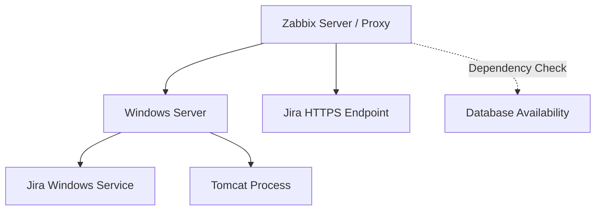
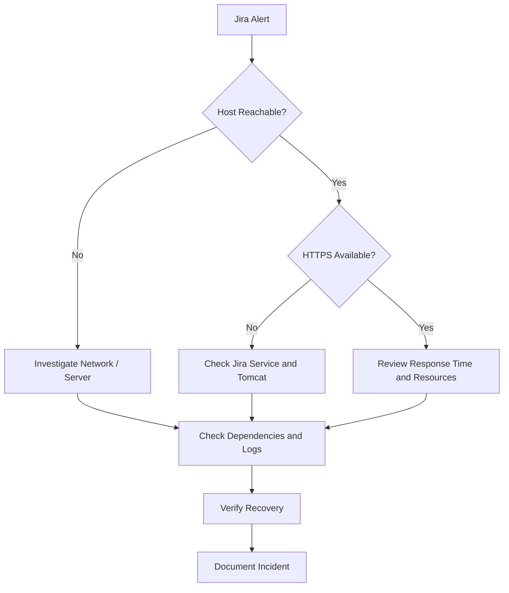

# Jira & Tomcat — Zabbix Monitoring Configuration

## 1. Overview

This document describes a layered Zabbix monitoring configuration for Jira running on Windows Server with a Tomcat-based application runtime.

The monitoring approach combines network checks, Windows service monitoring, process metrics, application availability, response-time measurements, and supporting infrastructure monitoring.

The configuration examples are based on enterprise monitoring experience and use anonymized infrastructure identifiers.

## 2. Monitoring Architecture



## 3. Monitoring Layers

| Layer | Metric | Method |
|---|---|---|
| Network | Reachability | ICMP |
| Network | Packet loss | ICMP |
| Network | Round-trip time | ICMP |
| Operating System | CPU and memory | Zabbix Agent |
| Storage | Disk usage | Zabbix Agent |
| Application | Jira Windows service | Zabbix Agent |
| Runtime | Tomcat process health | Process monitoring |
| Web | HTTPS availability | Web scenario |
| Web | Response time | Web scenario |
| Security | TLS certificate expiration | Certificate monitoring |
| Database | Availability | Database-specific monitoring |

## 4. Zabbix Monitoring Items

### 4.1 ICMP Availability

Type: Simple check

Key:

`icmpping`

Update interval: `1m`

Values:

- `1` — Host reachable
- `0` — Host unreachable

Additional ICMP metrics:

`icmppingloss`

`icmppingsec`

These metrics provide packet loss and round-trip time visibility.

### 4.2 Jira Windows Service

Type: Zabbix Agent

Key:

`service.info["jira",state]`

The service name `jira` is an example.

The actual Windows service identifier must match the installed application service.

The service state item can be used to generate alerts when the application service is no longer running.

### 4.3 Tomcat Process Monitoring

Tomcat monitoring includes:

- Process availability
- CPU utilization
- Memory consumption
- Runtime resource trends

Process identification depends on the installed application runtime and executable configuration.

For Java-based applications, process identification may require command-line matching rather than relying only on the executable name.

### 4.4 Operating System Resources

Recommended Windows Server monitoring includes:

- CPU utilization
- Available memory
- Disk free space
- Disk performance
- Network interface traffic
- Windows service availability
- Relevant operating system events

Standard Zabbix Windows templates provide reusable monitoring items and discovery rules.

## 5. Jira Web Scenario

Zabbix web scenarios can monitor application availability and response time.

Example scenario:

`Jira HTTPS Availability`

Example step:

| Parameter | Example |
|---|---|
| Step name | Jira Home |
| URL | https://jira.example.com/ |
| Expected status code | 200 |
| Timeout | 15s |
| Update interval | 1m |

The URL is an example.

Expected response codes, authentication behavior, and redirect handling must match the application endpoint.

### Generated Web Monitoring Items

Web scenarios automatically create monitoring items.

Failed step:

`web.test.fail[Jira HTTPS Availability]`

Response time:

`web.test.time[Jira HTTPS Availability,Jira Home,resp]`

HTTP response code:

`web.test.rspcode[Jira HTTPS Availability,Jira Home]`

These values can be used in application availability triggers and operational dashboards.

## 6. Trigger Expressions

The examples below use a Zabbix host named `Jira-Monitoring`.

### 6.1 Host Unreachable

Severity: High

```text
max(/Jira-Monitoring/icmpping,#3)=0
```

The trigger detects three consecutive failed ICMP checks.

### 6.2 Jira Service Not Running

Severity: High

```text
last(/Jira-Monitoring/service.info["jira",state])<>0
```

The trigger evaluates the Jira Windows service state.

The expected state and service identifier should be configured according to the monitored Windows installation.

### 6.3 Jira Web Scenario Failed

Severity: High

```text
last(/Jira-Monitoring/web.test.fail[Jira HTTPS Availability])<>0
```

The trigger detects failure of the Jira web scenario.

### 6.4 Elevated Jira Response Time

Severity: Warning

```text
avg(/Jira-Monitoring/web.test.time[Jira HTTPS Availability,Jira Home,resp],5m)>3
```

This example generates a warning when average response time exceeds three seconds over five minutes.

Response-time thresholds should reflect measured application performance and operational requirements.

## 7. Application Monitoring Dashboard

Recommended dashboard components include:

- Jira application availability
- Jira Windows service status
- Tomcat process metrics
- HTTPS response time
- Web scenario failures
- Windows Server CPU and memory
- Disk utilization
- Network availability
- TLS certificate expiration
- Active application alerts

Combining infrastructure and application metrics helps identify relationships between resource pressure and application behavior.

## 8. Incident Investigation Workflow



### Investigation Procedure

1. Identify the affected monitoring item and event time.
2. Confirm network connectivity to the Jira host.
3. Review HTTPS availability and response time.
4. Check Jira Windows service status.
5. Inspect Tomcat process and resource metrics.
6. Review operating system CPU, memory, disk, and network performance.
7. Check database availability and supporting dependencies.
8. Review relevant application and operating system logs.
9. Verify application recovery.
10. Document the incident and corrective action.

## 9. Monitoring Design Considerations

### Application and Infrastructure Availability

Host reachability alone does not confirm that Jira is functioning correctly.

Application-level HTTP checks should complement infrastructure monitoring.

### Windows Service Monitoring

A running Windows service does not guarantee successful application requests.

Service checks and web monitoring should be evaluated together.

### Tomcat Performance

Process metrics provide additional information about application runtime behavior.

Resource utilization should be correlated with response time and service availability.

### Alert Thresholds

Thresholds should be based on application requirements, operational baselines, and incident severity.

### Alert Correlation

Trigger dependencies can help reduce unnecessary notifications when a common infrastructure failure affects multiple services.

### Certificate Monitoring

TLS certificate monitoring should be configured independently of application response-time monitoring.

## 10. Operational Verification Checklist

### Host Monitoring

- [ ] Verify ICMP availability
- [ ] Confirm Zabbix Agent connectivity
- [ ] Review Windows resource metrics
- [ ] Verify the Jira Windows service name
- [ ] Confirm Tomcat process identification

### Web Monitoring

- [ ] Verify the Jira endpoint URL
- [ ] Review expected HTTP response codes
- [ ] Confirm web scenario item creation
- [ ] Inspect response-time values

### Trigger Configuration

- [ ] Review ICMP availability trigger
- [ ] Verify Jira service trigger
- [ ] Review web scenario failure trigger
- [ ] Check response-time thresholds
- [ ] Review trigger severity and dependencies

### Incident Response

- [ ] Review event notification configuration
- [ ] Confirm troubleshooting procedures
- [ ] Verify service recovery checks
- [ ] Document operational findings

## 11. Security Considerations

- Protect Zabbix Agent and application credentials.
- Restrict access to monitoring configuration.
- Avoid storing authentication tokens in public repositories.
- Use secure communication between monitoring components.
- Review access permissions for application endpoints.
- Exclude confidential hostnames, IP addresses, and organizational information from public documentation.

## 12. Related Documentation

- [Jira & Tomcat Monitoring](jira-tomcat-monitoring.md)
- [Monitoring Architecture](architecture.md)
- [Monitoring Dashboards and Alerting](monitoring-dashboards-alerting.md)
- [Incident Response Runbooks](incident-response-runbooks.md)

## 13. References

- [Zabbix Documentation](https://www.zabbix.com/documentation/current/)
- [Zabbix Web Monitoring](https://www.zabbix.com/documentation/current/en/manual/web_monitoring)
- [Zabbix Windows Agent Monitoring](https://www.zabbix.com/documentation/current/en/manual/config/items/itemtypes/zabbix_agent/win_keys)
