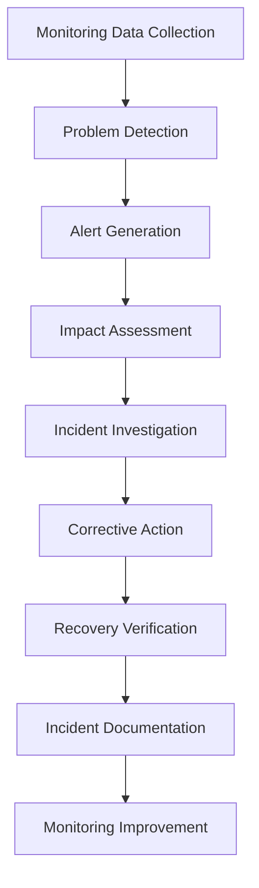

# Enterprise Monitoring Dashboards & Alerting

## 1. Overview

This document describes operational monitoring dashboards, alerting strategies, and incident response workflows for a distributed enterprise IT environment.

The monitoring approach covers:

- Branch WAN connectivity
- Windows and Linux infrastructure
- Jira and Tomcat application monitoring
- SharePoint portal availability
- Nextcloud service monitoring
- Incident detection and response

The primary technologies are Zabbix and Netdata.

The design draws on enterprise infrastructure monitoring experience in an environment supporting more than 1,000 users across 31 branch offices.

Infrastructure identifiers and examples are anonymized.

## 2. Dashboard Design Principles

An operational dashboard should answer:

1. What is currently unavailable or degraded?
2. Which service or infrastructure component is affected?
3. What requires immediate investigation?

Effective dashboards prioritize:

- Business-critical service availability
- Clear problem indicators
- Relevant performance metrics
- Historical trends
- Appropriate alert severity
- Actionable information

## 3. Network Operations Dashboard

### Objective

Provide centralized visibility into branch connectivity and primary/backup WAN availability.

### Recommended Widgets

| Widget | Purpose |
|---|---|
| Branch Availability | Overall connectivity status |
| Primary WAN Status | Primary link availability |
| Backup WAN Status | Backup link availability |
| Active Problems | Current connectivity incidents |
| Packet Loss | ICMP packet loss trends |
| Network Latency | Response-time trends |
| Recent Events | Connectivity incident history |

### WAN Alert Severity

| Condition | Severity |
|---|---|
| Primary WAN unavailable | High |
| Backup WAN unavailable | Warning |
| Both WAN links unavailable | Disaster |
| Elevated packet loss | Warning |
| High latency | Warning |

Alert severity should reflect operational requirements and business impact.

Trigger dependencies can reduce duplicate notifications when both WAN links become unavailable.

## 4. Server Infrastructure Dashboard

### Objective

Monitor the availability and resource utilization of Windows and Linux servers.

### Key Metrics

- Host availability
- CPU utilization
- Memory consumption
- Disk capacity
- Disk I/O
- Network interface traffic
- Operating system service availability
- Zabbix Agent availability

### Operational Use

The dashboard supports investigation of:

- Server outages
- Resource exhaustion
- Disk capacity problems
- Service interruptions
- Performance degradation
- Monitoring communication failures

Historical metrics help distinguish temporary spikes from sustained resource pressure.

## 5. Jira & Tomcat Dashboard

### Objective

Monitor Jira availability and supporting Windows Server and Tomcat components.

### Monitoring Coverage

| Layer | Metrics |
|---|---|
| Network | ICMP availability and latency |
| Web | HTTPS availability and response time |
| Application | Jira Windows service state |
| Runtime | Tomcat process and resource utilization |
| Operating System | CPU, memory, disk and network |
| Certificates | TLS certificate expiration |

### Incident Investigation

1. Confirm host connectivity.
2. Review HTTPS availability.
3. Check Jira Windows service status.
4. Inspect Tomcat process metrics.
5. Review operating system resource utilization.
6. Investigate database and application dependencies.
7. Verify recovery.

## 6. SharePoint Portal Dashboard

### Objective

Provide operational visibility into SharePoint availability, IIS, and SQL Server dependencies.

### Monitoring Areas

- HTTP/HTTPS availability
- Authenticated web scenario checks
- Application response time
- IIS service availability
- Windows Server resource utilization
- SQL Server service health
- Database-related performance indicators

### Operational Analysis

Portal performance issues may originate from IIS, server resource pressure, database dependencies, authentication, or network connectivity.

Correlating web response time with infrastructure metrics supports structured troubleshooting.

## 7. Nextcloud Dashboard

### Objective

Monitor Nextcloud availability and supporting Linux services.

### Monitoring Areas

- HTTPS availability and response time
- Application status endpoint
- Linux CPU and memory utilization
- Filesystem capacity
- Apache and PHP service health
- MariaDB availability
- Redis connectivity
- Cron background jobs
- LDAP dependencies
- TLS certificate expiration

These monitoring areas provide a reference for layered Nextcloud observability.

## 8. Netdata Performance Monitoring

Netdata complements centralized Zabbix monitoring through detailed system performance metrics.

### Key Metrics

- CPU utilization
- Memory consumption
- Disk I/O
- Network traffic
- System performance trends
- Process resource utilization

### Platform Responsibilities

| Platform | Primary Role |
|---|---|
| Zabbix | Monitoring configuration, triggers, alerts and dashboards |
| Netdata | Detailed system performance visibility and analysis |

A Netdata Parent-Child architecture supports centralized metric streaming from monitored nodes.

## 9. Alerting Strategy

### Severity Classification

| Severity | Meaning |
|---|---|
| Information | Informational event |
| Warning | Early degradation |
| Average | Condition requiring investigation |
| High | Significant service or infrastructure failure |
| Disaster | Critical business-impacting outage |

### Alert Quality

Effective alerts should provide:

- Affected host or service
- Detected condition
- Relevant monitoring values
- Severity
- Event timestamp
- Clear investigation context

### Alert Noise Reduction

Recommended techniques:

- Meaningful trigger thresholds
- Trigger dependencies
- Appropriate recovery expressions
- Maintenance windows
- Escalation policies
- Periodic alert review

## 10. Notification and Escalation

A typical notification workflow includes:

1. Zabbix detects an abnormal condition.
2. A trigger generates a problem event.
3. Event severity is evaluated.
4. Configured actions determine notification recipients.
5. Engineers investigate the problem.
6. Recovery is confirmed.
7. The incident is documented.

### Example Escalation Scenarios

| Condition | Operational Response |
|---|---|
| Primary WAN unavailable | Investigate provider and routing |
| Backup WAN unavailable | Review backup connection |
| Both WAN links unavailable | Prioritize complete branch outage |
| Jira unavailable | Investigate application dependencies |
| SharePoint unavailable | Check IIS and SQL Server |
| Disk capacity critical | Investigate storage utilization |

## 11. Incident Response Workflow

### Investigation Principles

- Verify the alert before making changes.
- Identify the affected service.
- Review relevant infrastructure dependencies.
- Compare current metrics with historical trends.
- Investigate logs and monitoring events.
- Apply approved corrective procedures.
- Verify recovery.
- Document findings.

## 12. Monitoring Reports

Monitoring data can support:

- Availability reporting
- Incident trend analysis
- WAN reliability reviews
- Server capacity planning
- Application performance analysis
- Identification of recurring problems
- Review of monitoring thresholds

Reports should distinguish observed measurements from estimates and assumptions.

## 13. Operational Verification Checklist

### Dashboards

- [ ] Review critical service visibility
- [ ] Confirm branch connectivity indicators
- [ ] Verify application monitoring widgets
- [ ] Check server resource graphs
- [ ] Review active problems

### Alerting

- [ ] Review trigger thresholds
- [ ] Confirm severity classification
- [ ] Verify notification rules
- [ ] Review trigger dependencies
- [ ] Confirm escalation responsibilities

### Incident Response

- [ ] Review investigation procedures
- [ ] Verify service dependency information
- [ ] Confirm recovery checks
- [ ] Review incident documentation

### Reporting

- [ ] Review historical monitoring data
- [ ] Check availability trends
- [ ] Analyze recurring incidents
- [ ] Review capacity-related metrics

## 14. Monitoring Best Practices

- Prioritize business-critical services.
- Use standardized templates.
- Define meaningful alert severity.
- Monitor applications separately from host availability.
- Correlate infrastructure and application metrics.
- Maintain troubleshooting documentation.
- Protect monitoring credentials.
- Review dashboards regularly.
- Improve alerting based on operational experience.

## 15. Related Documentation

- [Monitoring Architecture](architecture.md)
- [Branch WAN Monitoring](branch-wan-monitoring.md)
- [Jira & Tomcat Monitoring](jira-tomcat-monitoring.md)
- [SharePoint Portal Monitoring](sharepoint-portal-monitoring.md)
- [Nextcloud Service Monitoring](nextcloud-service-monitoring.md)
- [Netdata Parent-Agent Monitoring](netdata-parent-agent-monitoring.md)
- [Incident Response Runbooks](incident-response-runbooks.md)

## 16. References

- [Zabbix Documentation](https://www.zabbix.com/documentation/current/)
- [Netdata Documentation](https://learn.netdata.cloud/)
