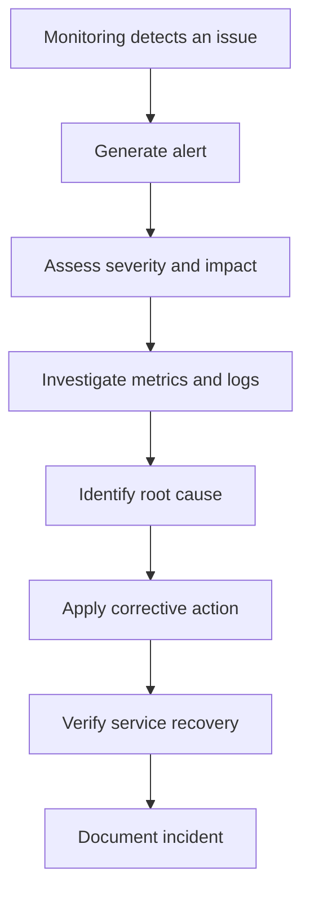

# Enterprise Monitoring Dashboards & Alerting

## 1. Overview

This case study describes the design of operational monitoring dashboards and alerting workflows for a distributed enterprise environment.

The monitoring approach focuses on four areas:

- Network and WAN connectivity
- Server and infrastructure health
- Business-critical application availability
- Incident detection and response

The primary monitoring technologies are Zabbix and Netdata.

All examples are anonymized. Dashboard configurations and alerting scenarios will be validated in a dedicated lab.

## 2. Dashboard Design Principles

Effective monitoring dashboards should help engineers answer three questions:

1. What is currently unavailable or degraded?
2. Which infrastructure component or service is affected?
3. What requires immediate investigation?

Dashboards should prioritize operational relevance rather than displaying every available metric.

## 3. Network Operations Dashboard

### Purpose

Provide visibility into the connectivity status of enterprise branches and their primary and backup WAN connections.

### Recommended Widgets

| Widget | Description |
|---|---|
| Branch Availability | Overall connectivity status |
| Primary WAN Status | Availability of primary links |
| Backup WAN Status | Availability of backup links |
| Active Network Problems | Current connectivity incidents |
| Packet Loss | ICMP packet loss trends |
| Network Latency | ICMP response time trends |

### Alert Severity

| Condition | Proposed Severity |
|---|---|
| Primary WAN unavailable | High |
| Backup WAN unavailable | Warning |
| Both WAN links unavailable | Disaster |
| Elevated packet loss | Warning |
| High latency | Warning |

Thresholds must be calibrated according to normal network behavior.

## 4. Server Infrastructure Dashboard

### Purpose

Monitor the availability and resource consumption of Windows and Linux servers.

### Key Metrics

- Host availability
- CPU utilization
- Memory utilization
- Disk space utilization
- Network interface traffic
- Critical operating system services
- Monitoring agent availability

### Operational Use

The dashboard supports investigation of resource exhaustion, service failures, and infrastructure degradation.

## 5. Jira & Tomcat Dashboard

### Purpose

Monitor the availability and health of the Jira application and its supporting Tomcat environment.

### Key Monitoring Areas

- ICMP reachability
- HTTP/HTTPS availability
- HTTP response time
- Tomcat process and service status
- CPU and memory utilization
- Disk utilization
- Network traffic

### Troubleshooting Approach

If Jira becomes unavailable:

1. Verify host reachability.
2. Check HTTP/HTTPS availability.
3. Review the Tomcat process or service status.
4. Examine CPU, memory, and disk resources.
5. Review relevant application logs.
6. Investigate dependencies where necessary.

## 6. SharePoint Portal Dashboard

### Purpose

Provide operational visibility into SharePoint portal availability and supporting infrastructure.

### Monitoring Areas

- Web endpoint availability
- HTTP response time
- IIS application and service health
- Windows Server resource utilization
- SQL Server dependencies
- Storage and disk performance

The exact SQL and IIS checks must be validated against the target SharePoint environment.

## 7. Nextcloud Dashboard

### Purpose

Monitor Nextcloud service health and its underlying infrastructure.

### Monitoring Areas

- Web availability and response time
- Server CPU, memory, and disk utilization
- Database availability
- Redis service health
- Background job and cron execution
- Application logs and operational errors

The monitoring configuration will be reproduced and validated in a lab environment.

## 8. Alerting Strategy

### Event Severity

Monitoring events are classified according to their operational impact.

A proposed severity model:

- Information: Informational events
- Warning: Early indications of degradation
- Average: Service conditions requiring investigation
- High: Significant service or infrastructure failures
- Disaster: Critical outages affecting business operations

### Alert Quality

Effective alerts should:

- Identify the affected host or service
- Explain the detected condition
- Include relevant monitoring values
- Avoid unnecessary duplicate notifications
- Provide a clear path for investigation

## 9. Incident Response Workflow

## 10. Reporting and Continuous Improvement

Monitoring data can support:

- Availability reporting
- Incident trend analysis
- Capacity planning
- Identification of recurring faults
- Review of alert thresholds
- Improvement of troubleshooting procedures

Reports should distinguish observed data from assumptions and estimated impact.

## 11. Future Lab Validation

- [ ] Build a network operations dashboard
- [ ] Build server monitoring dashboards
- [ ] Create application-specific dashboards
- [ ] Validate trigger severities and thresholds
- [ ] Test notification workflows
- [ ] Capture anonymized screenshots
- [ ] Document incident response test cases

## 12. Lessons Learned

Operational monitoring is most valuable when infrastructure metrics are connected to service impact.

Clear dashboards, meaningful alerts, and consistent incident response procedures help engineering teams identify problems and investigate them systematically.
