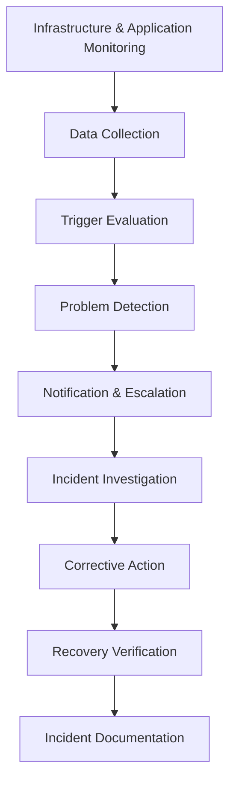

# Enterprise Monitoring — Technical Project Index

## Overview

This repository documents enterprise infrastructure monitoring, service availability, operational dashboards, and incident troubleshooting practices.

The technical portfolio is based on infrastructure operations experience in a distributed enterprise environment supporting more than 1,000 users across 31 branch offices.

The documentation covers Zabbix, Zabbix Proxy, Netdata, WAN connectivity, Windows and Linux infrastructure, and business-critical applications.

All configuration examples and infrastructure identifiers are anonymized.

## 1. Architecture & Monitoring Infrastructure

| Document | Technical Scope |
|---|---|
| [Monitoring Architecture](architecture.md) | Central Zabbix Server, distributed proxies, network segmentation and Netdata |
| [Zabbix Proxy Deployment](zabbix-proxy-deployment.md) | Active proxies, Debian 12, Office/DMZ monitoring and encrypted communication |
| [Netdata Parent-Agent Monitoring](netdata-parent-agent-monitoring.md) | Centralized metrics streaming, Linux resource monitoring and GitLab performance visibility |
| [Monitoring Dashboards & Alerting](monitoring-dashboards-alerting.md) | Operational dashboards, monitoring metrics, trigger severity and notifications |

## 2. Network & WAN Monitoring

| Document | Technical Scope |
|---|---|
| [Branch WAN Monitoring](branch-wan-monitoring.md) | Primary and backup WAN links, ICMP, packet loss, latency and outage detection |

### Key Topics

- Branch connectivity monitoring
- Primary and backup link availability
- Zabbix host macros
- ICMP monitoring items
- Link failure triggers
- Combined outage detection
- Network incident investigation

## 3. Enterprise Application Monitoring

| Document | Technical Scope |
|---|---|
| [Jira & Tomcat Monitoring](jira-tomcat-monitoring.md) | Jira availability, Windows services, Tomcat performance and HTTPS monitoring |
| [Jira Zabbix Configuration](jira-zabbix-configuration.md) | Monitoring items, web scenarios and trigger expressions |
| [SharePoint Portal Monitoring](sharepoint-portal-monitoring.md) | IIS, web availability, NTLM authentication and SQL Server dependencies |
| [SharePoint Zabbix Configuration](sharepoint-zabbix-configuration.md) | Web scenarios, service monitoring and application performance |
| [Nextcloud Service Monitoring](nextcloud-service-monitoring.md) | Nextcloud availability, Apache, PHP, Redis, MariaDB, Cron and LDAP |
| [Nextcloud Zabbix Configuration](nextcloud-zabbix-configuration.md) | Monitoring items, HTTPS checks, application status and service dependencies |

## 4. IT Operations & Incident Management

| Document | Technical Scope |
|---|---|
| [Incident Response Runbooks](incident-response-runbooks.md) | WAN, Jira, SharePoint, Nextcloud and Zabbix Proxy troubleshooting |
| [Monitoring Dashboards & Alerting](monitoring-dashboards-alerting.md) | Event classification, notifications, escalation and incident response |

### Operational Workflow

## 5. Configuration Examples

### Dual-Link WAN Monitoring Template

[Zabbix 7.4 Dual WAN Template](../template_wan_dual_link_zabbix74.yaml)

The template provides an example configuration for monitoring primary and backup branch WAN connectivity.

Key configuration concepts:

- Host macros
- ICMP availability items
- Packet loss metrics
- Response-time metrics
- Primary WAN failure detection
- Backup WAN failure detection
- Combined WAN outage detection

Configuration examples should be reviewed for compatibility with the target Zabbix environment before operational use.

## 6. Technology Stack

| Technology | Area |
|---|---|
| Zabbix 7.4 | Infrastructure and service monitoring |
| Zabbix Proxy | Distributed data collection |
| Netdata | System performance monitoring |
| Debian Linux | Monitoring server platform |
| PostgreSQL | Monitoring database |
| Nginx | Web frontend |
| Windows Server | Enterprise application infrastructure |
| Jira / Tomcat | Application monitoring |
| SharePoint / IIS | Enterprise portal monitoring |
| Microsoft SQL Server | Database dependency monitoring |
| Nextcloud | Collaboration service monitoring |
| MariaDB / Redis | Application dependencies |
| Cisco Networking | Network and WAN operations |

## 7. Engineering Focus

The portfolio emphasizes:

- Enterprise infrastructure operations
- Monitoring architecture
- Distributed data collection
- Service availability
- Network connectivity
- Application dependencies
- Performance investigation
- Alerting and escalation
- Incident response
- Technical documentation

## 8. Security & Confidentiality

- Infrastructure identifiers are anonymized.
- Production credentials and authentication secrets are excluded.
- Internal network details are not intentionally published.
- Example configurations use generic hostnames and addresses.
- Sensitive logs and organizational information must not be committed.
- Public documentation should be reviewed for confidentiality before publication.

## 9. Repository Navigation

[Return to Main README](../README.md)

### External References

- [Zabbix Documentation](https://www.zabbix.com/documentation/current/)
- [Netdata Documentation](https://learn.netdata.cloud/)
