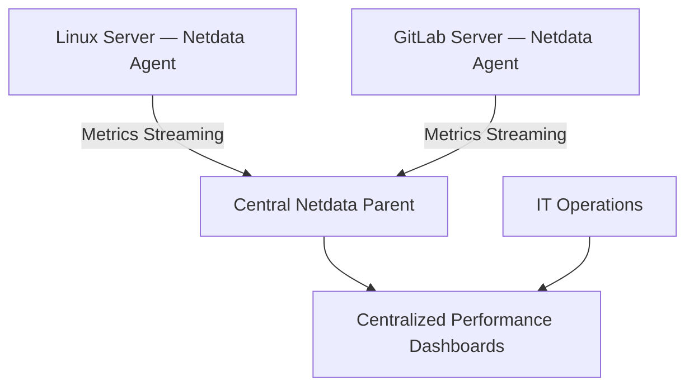

# Netdata — Parent-Agent Monitoring Architecture

## 1. Overview

This case study documents a centralized infrastructure performance monitoring architecture using Netdata Parent and distributed Netdata Agents.

The architecture is based on hands-on enterprise infrastructure monitoring experience involving Linux servers and application services.

The primary objective is to collect detailed system performance metrics from multiple hosts and provide centralized visibility for troubleshooting, performance investigation, and capacity analysis.

Infrastructure identifiers and configuration examples are anonymized.

## 2. Technology Stack

| Component | Technology |
|---|---|
| Monitoring Platform | Netdata |
| Central Metrics Collection | Netdata Parent |
| Distributed Monitoring | Netdata Agents |
| Operating Systems | Linux |
| Application Infrastructure | GitLab and supporting services |
| Metrics Transport | Netdata Streaming |
| Complementary Monitoring | Zabbix |

## 3. Monitoring Architecture



The diagram illustrates the logical Parent-Agent architecture and centralized metric collection.

## 4. Netdata Parent

The Netdata Parent acts as the central receiving and visualization point for metrics streamed from distributed Agents.

### Key Responsibilities

- Receive metrics from authorized Agents
- Provide centralized visibility into monitored servers
- Maintain historical metrics according to configured retention
- Support cross-server performance analysis
- Assist troubleshooting of infrastructure and application issues

### Operational Considerations

The Parent requires sufficient:

- CPU and memory resources
- Storage capacity
- Network connectivity
- Data retention configuration
- Access controls

Capacity requirements depend on the number of monitored nodes, metrics volume, and retention settings.

## 5. Netdata Agents

Netdata Agents collect system and application metrics locally.

### Monitoring Coverage

Typical metrics include:

- CPU utilization and system load
- Memory consumption
- Disk I/O
- Filesystem utilization
- Network interface traffic
- System process activity
- Application-specific metrics where available

The Agents can stream collected metrics to the central Parent.

### Operational Benefits

Distributed collection enables performance visibility across multiple hosts while preserving a centralized point for analysis.

## 6. Metrics Streaming

Netdata streaming enables an Agent to send collected metrics to a configured Parent.

The architecture involves configuration on both the receiving Parent and sending Agent.

### Parent Configuration

The Parent must be configured to accept connections from authorized Agents.

Important configuration areas include:

- Streaming API key
- Allowed sender addresses
- Network access controls
- Metrics storage and retention
- Receiving connection settings

### Agent Configuration

The sending Agent requires:

- Streaming enabled
- Parent destination
- Streaming API key
- Appropriate connection settings

### Example Agent Configuration

The following illustrates the main settings in `stream.conf`:

```ini
[stream]
    enabled = yes
    destination = netdata-parent.example.com:19999
    api key = 11111111-2222-3333-4444-555555555555
```

The API key and hostname are examples.

The Parent must authorize the corresponding streaming API key and sender.

### Example Parent Configuration

```ini
[11111111-2222-3333-4444-555555555555]
    enabled = yes
    allow from = 192.0.2.*
```

The example uses a documentation-only IP range.

Actual configuration syntax and available options should be checked against the installed Netdata version.

## 7. GitLab Performance Monitoring

GitLab was one of the application environments included in the infrastructure monitoring work.

The monitoring approach focuses on system resource visibility and supporting application performance metrics.

### Relevant Monitoring Areas

- CPU utilization
- Memory consumption
- Disk I/O
- Storage capacity
- Network traffic
- GitLab-related processes
- Puma application-server metrics where supported

Application-specific metric availability depends on the installed GitLab components and Netdata collectors.

### Operational Analysis

Resource metrics can help investigate:

- High CPU consumption
- Memory pressure
- Storage bottlenecks
- Network utilization
- Application performance degradation

Monitoring data should be correlated with application logs and service metrics when investigating incidents.

## 8. Centralized Performance Dashboard

A centralized dashboard provides visibility into monitored Linux nodes.

Recommended dashboard areas include:

| Dashboard Area | Metrics |
|---|---|
| CPU | Utilization and system load |
| Memory | Used, available and cached memory |
| Storage | Disk I/O and filesystem utilization |
| Network | Interface traffic |
| Processes | Resource utilization |
| Application | GitLab-related metrics where available |

Historical metrics help identify recurring performance patterns and capacity-related concerns.

## 9. Troubleshooting Streaming Issues

### Common Symptoms

- Agent metrics stop updating
- Expected nodes are missing from the Parent
- Metric collection is interrupted
- Streaming connections fail
- Monitoring data becomes stale

### Investigation Procedure

1. Verify Agent-to-Parent connectivity.
2. Check Netdata service status.
3. Review Agent streaming configuration.
4. Confirm Parent address and port.
5. Verify streaming API key configuration.
6. Review firewall permissions.
7. Inspect Netdata logs.
8. Confirm that metrics resume updating.

### Example Linux Commands

Check the Netdata service:

```bash
sudo systemctl status netdata
```

Review recent logs:

```bash
sudo journalctl -u netdata -n 100 --no-pager
```

Check connectivity to the Parent:

```bash
nc -vz netdata-parent.example.com 19999
```

Review streaming configuration without exposing credentials:

```bash
sudo grep -E 'enabled|destination' /etc/netdata/stream.conf
```

The configuration file path may differ depending on the installation method.

### Recovery Verification

- Confirm Agent service availability.
- Verify streaming connectivity.
- Check the Parent dashboard.
- Confirm fresh metrics from the affected Agent.
- Review resource and network stability.

## 10. Security Considerations

- Restrict streaming connections to authorized Agents.
- Protect API keys and configuration files.
- Use appropriate network segmentation.
- Apply firewall restrictions.
- Use encrypted transport where supported and configured.
- Restrict access to monitoring dashboards.
- Avoid exposing monitoring endpoints publicly without appropriate protection.
- Exclude production secrets and internal network details from public repositories.

## 11. Operational Verification Checklist

### Netdata Parent

- [ ] Verify Netdata service status
- [ ] Review receiving configuration
- [ ] Confirm authorized streaming connections
- [ ] Inspect storage and retention settings
- [ ] Review system resource utilization

### Netdata Agents

- [ ] Verify Agent service availability
- [ ] Confirm streaming configuration
- [ ] Check Parent connectivity
- [ ] Review collected metrics
- [ ] Confirm fresh data in the Parent dashboard

### Monitoring Quality

- [ ] Review CPU and memory metrics
- [ ] Inspect disk and network performance
- [ ] Verify application metrics where available
- [ ] Review historical performance trends

### Security

- [ ] Protect streaming credentials
- [ ] Review firewall permissions
- [ ] Restrict monitoring dashboard access
- [ ] Exclude sensitive configuration data from public documentation

## 12. Netdata and Zabbix Integration in Operations

Zabbix and Netdata provide complementary monitoring capabilities.

| Platform | Operational Focus |
|---|---|
| Zabbix | Monitoring configuration, triggers, alerts and service availability |
| Netdata | Detailed system performance metrics and resource analysis |

Zabbix provides structured event detection and notification workflows.

Netdata adds detailed performance visibility that can help engineers investigate resource consumption and application behavior.

Using both platforms supports a broader understanding of infrastructure health.

## 13. Lessons Learned

Centralized monitoring is most effective when availability checks and detailed performance metrics are analyzed together.

A Parent-Agent architecture provides centralized performance visibility while allowing metrics to be collected locally on distributed infrastructure.

Reliable operation depends on correct streaming configuration, network connectivity, security controls, and consistent troubleshooting procedures.

## 14. Related Documentation

- [Monitoring Architecture](architecture.md)
- [Monitoring Dashboards and Alerting](monitoring-dashboards-alerting.md)
- [Incident Response Runbooks](incident-response-runbooks.md)

## 15. References

- [Netdata Documentation](https://learn.netdata.cloud/)
- [Zabbix Documentation](https://www.zabbix.com/documentation/current/)
