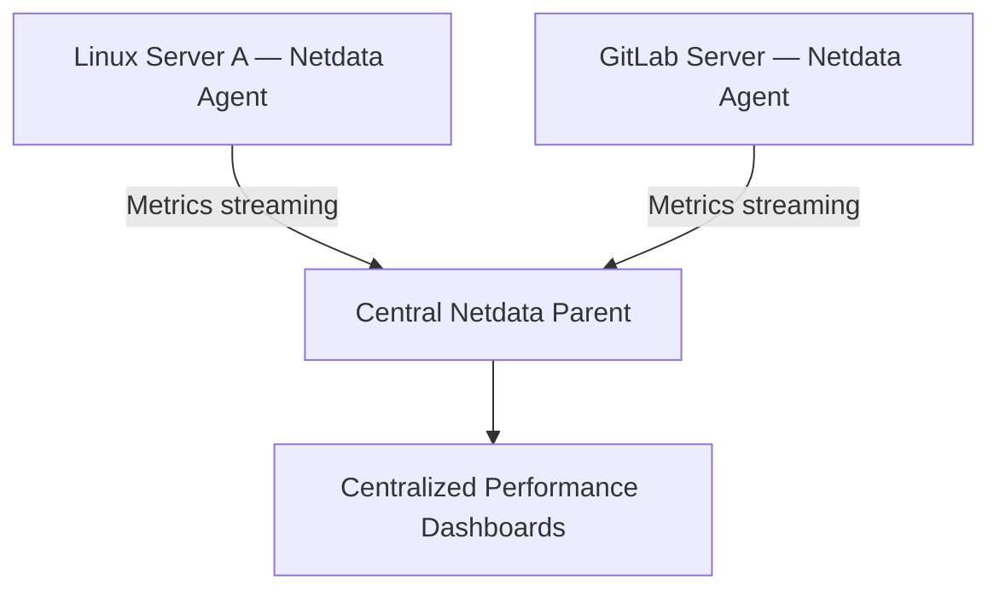
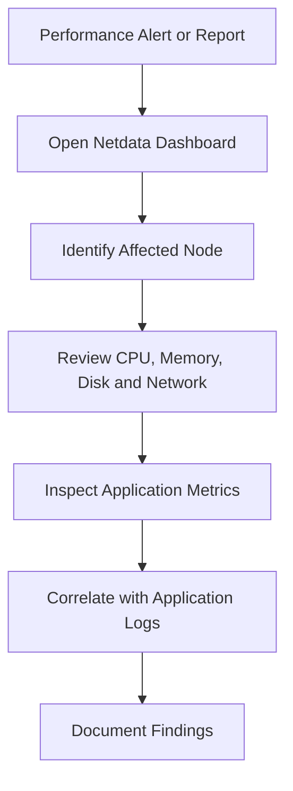

# Netdata — Parent-Agent Monitoring Architecture

## 1. Project Overview

This case study documents a centralized performance monitoring architecture using Netdata Parent and distributed Netdata Agents.

The implementation is based on hands-on infrastructure monitoring work in an enterprise environment.

The objective is to collect detailed system and application metrics from multiple servers and provide centralized visibility into performance and resource utilization.

All hostnames, network addresses, and configuration examples in this document are anonymized.

## 2. Technology Stack

| Component | Technology |
|---|---|
| Monitoring platform | Netdata |
| Central collection | Netdata Parent |
| Distributed collection | Netdata Agents |
| Operating systems | Linux servers |
| Application monitoring | GitLab and supporting services |
| Data transport | Netdata metrics streaming |

## 3. Monitoring Architecture

This diagram represents the logical monitoring architecture, not an actual production network topology.

## 4. Netdata Parent

The central Netdata Parent acts as a collection point for metrics streamed from distributed agents.

Key responsibilities include:

- Receiving metrics from authorized agents
- Providing centralized visibility into monitored nodes
- Supporting analysis of historical performance data
- Simplifying performance investigation across servers

The actual data retention and storage configuration depend on the deployed environment.

## 5. Netdata Agents

Netdata Agents collect detailed performance metrics locally and stream them to the Parent.

Typical monitoring areas include:

- CPU utilization and load
- Memory consumption
- Disk I/O and filesystem activity
- Network interface traffic
- System processes
- Application-specific metrics where supported

Agent collection and streaming should be validated independently.

## 6. Streaming Configuration Concepts

A typical Netdata streaming setup requires configuration on both the Parent and Agent sides.

### Parent Configuration

The Parent must be configured to accept streaming connections from authorized agents.

Important concepts include:

- Streaming API key
- Allowed sender addresses
- Storage and retention settings
- Network access controls

### Agent Configuration

Each Agent requires settings that identify:

- Whether streaming is enabled
- The Parent destination
- The streaming API key
- Applicable connection and transport settings

Actual configuration directives depend on the installed Netdata version.

Production API keys, internal IP addresses, and access rules must never be committed to this repository.

## 7. GitLab Performance Monitoring

One of the monitored application environments included GitLab.

The monitoring approach focused on collecting system and application performance metrics to support troubleshooting and capacity analysis.

### Relevant Metrics

- Host CPU and memory utilization
- Disk I/O and storage activity
- Network traffic
- GitLab-related process resource consumption
- Puma application-server metrics, where available

Application-specific collectors and metric availability must be confirmed against the running GitLab and Netdata versions.

## 8. Incident Investigation Workflow

## 9. Troubleshooting Streaming Issues

### Symptoms

- An Agent stops updating
- Expected metrics are missing from the Parent
- A monitored node becomes unavailable

### Investigation Steps

1. Verify connectivity between the Agent and Parent.
2. Check the Netdata service status on both hosts.
3. Review the Agent streaming configuration.
4. Verify the Parent destination and API key configuration.
5. Check network and firewall permissions.
6. Review Netdata logs for connection or authentication errors.
7. Confirm that metrics resume updating.

## 10. Security Considerations

- Restrict streaming access to authorized agents.
- Protect API keys and configuration files.
- Use encrypted transport where configured and supported.
- Avoid exposing monitoring endpoints unnecessarily.
- Review network access between monitoring components.
- Do not publish production configuration files without sanitization.

## 11. Implementation Status

| Area | Status |
|---|---|
| Central Netdata Parent | Previously implemented |
| Distributed Netdata Agents | Previously implemented |
| Metrics streaming | Previously configured |
| GitLab-related performance monitoring | Previously investigated |
| Public example configuration | Planned |
| Reproducible lab deployment | Pending |
| Failure simulation and screenshots | Pending |

## 12. Future Lab Validation

- [ ] Deploy a dedicated Netdata Parent
- [ ] Install two Netdata Agents
- [ ] Configure authorized metrics streaming
- [ ] Verify centralized metric collection
- [ ] Validate system resource metrics
- [ ] Configure GitLab-related monitoring in a lab
- [ ] Test Agent-to-Parent communication failures
- [ ] Add anonymized screenshots and configuration examples

## 13. Lessons Learned

Centralized performance monitoring complements infrastructure availability monitoring.

While Zabbix provides structured monitoring, triggers, and alerting workflows, Netdata adds detailed performance visibility that can assist with troubleshooting and resource analysis.

Using both technologies can provide a broader view of infrastructure health and application behavior.
