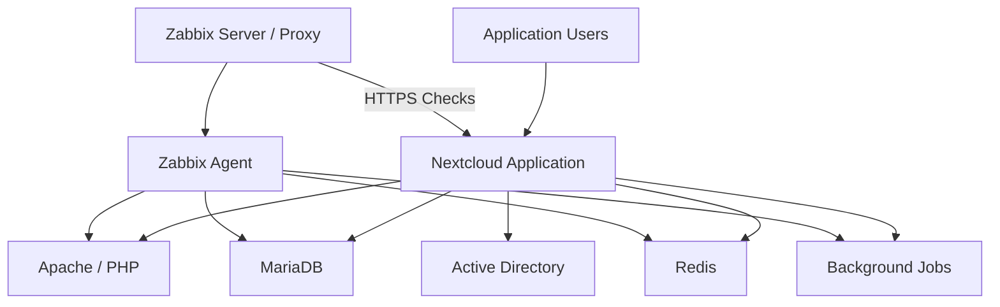
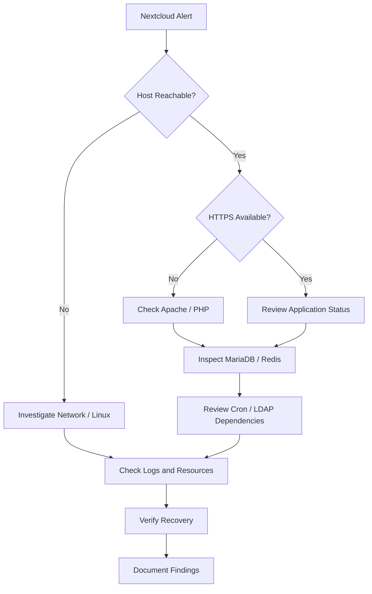

# Nextcloud — Service Monitoring & Operational Checks

## 1. Overview

This document presents an operational monitoring design for a self-hosted Nextcloud collaboration platform.

The monitoring approach covers application availability, Linux server resources, database dependencies, Redis, background jobs, authentication services, and TLS certificate health.

The design draws on hands-on Nextcloud administration experience, including service configuration, Active Directory integration, and user quota management.

The monitoring scenarios provide a reusable reference for infrastructure and application operations.

## 2. Service Architecture

A typical self-hosted Nextcloud deployment includes:

| Component | Role |
|---|---|
| Nextcloud | Collaboration and file-sharing application |
| Apache | HTTP/HTTPS web service |
| PHP | Application runtime |
| MariaDB | Application database |
| Redis | Caching and file locking |
| Cron | Scheduled background tasks |
| Active Directory | User identity integration |
| Linux | Operating system |
| Zabbix | Infrastructure and service monitoring |

## 3. Logical Monitoring Architecture

The diagram illustrates logical application dependencies and possible monitoring collection paths.

## 4. Monitoring Objectives

- Detect application availability failures
- Monitor HTTPS response time
- Observe Linux server resource utilization
- Detect supporting service interruptions
- Monitor database and Redis availability
- Identify background job execution problems
- Monitor TLS certificate expiration
- Support incident investigation and troubleshooting

## 5. Monitoring Layers

| Layer | Monitoring Signal | Purpose |
|---|---|---|
| Network | ICMP availability | Detect host reachability problems |
| Web | HTTPS availability and response time | Detect application access issues |
| Application | Nextcloud status endpoint | Evaluate application state |
| Linux | CPU, memory, disk and network | Identify resource constraints |
| Database | MariaDB service availability | Detect database dependency failures |
| Cache | Redis service status | Detect caching and locking issues |
| Background Jobs | Cron execution freshness | Detect delayed background processing |
| Authentication | Identity service availability | Investigate authentication dependencies |
| Security | TLS certificate expiration | Support certificate renewal planning |

## 6. Application Availability Monitoring

Nextcloud availability can be evaluated through multiple checks.

### HTTPS Monitoring

Zabbix web scenarios can check:

- Application endpoint reachability
- HTTP response codes
- Response time
- Web scenario failures

Example endpoint:

`https://nextcloud.example.com/`

The address is illustrative.

### Application Status Endpoint

Nextcloud exposes application status information through its status endpoint:

`https://nextcloud.example.com/status.php`

Relevant application status fields can include:

- Installed state
- Maintenance mode
- Update requirement
- Application version

Application status checks provide additional visibility beyond basic web server reachability.

## 7. Linux Infrastructure Monitoring

Infrastructure monitoring covers:

- CPU utilization
- Memory consumption
- Filesystem capacity
- Disk I/O
- Network traffic
- Operating system availability

Storage capacity is particularly important for file-sharing platforms because insufficient disk space can affect application operations and uploads.

## 8. Apache and PHP Monitoring

Monitoring areas include:

- Apache service availability
- HTTP/HTTPS response time
- PHP application errors
- Web server resource consumption
- Relevant application and system logs

For deployments using PHP-FPM, the appropriate PHP-FPM service can also be monitored.

Monitoring configuration should reflect the web server and PHP execution model in use.

## 9. Database Monitoring

MariaDB is a critical Nextcloud dependency.

Monitoring areas include:

- Database service availability
- Database connectivity
- CPU and memory utilization
- Storage capacity
- Database-related errors
- Connection and query performance where appropriate

Database availability should be correlated with application response time and error conditions.

## 10. Redis Monitoring

Redis may support caching and transactional file locking.

Monitoring considerations include:

- Redis service availability
- Redis connectivity
- Memory consumption
- Relevant error logs
- Application behavior during Redis failures

A running Redis process alone does not guarantee that Nextcloud can communicate with it successfully.

## 11. Background Job Monitoring

Nextcloud uses scheduled background jobs for maintenance and asynchronous operations.

Monitoring should consider:

- Cron service or timer availability
- Background job execution freshness
- Scheduled task failures
- Relevant application log entries

Monitoring job execution is more informative than checking only whether the system cron service is running.

## 12. Identity Integration

Nextcloud can integrate with Active Directory through LDAP.

Operational monitoring considerations include:

- Directory server availability
- LDAP connectivity
- Authentication-related application errors
- Certificate and connection security

Synthetic authentication checks require controlled credentials and should avoid exposing real user information.

## 13. TLS Certificate Monitoring

Certificate monitoring supports:

- Certificate expiration tracking
- Renewal notifications
- HTTPS availability checks
- Identification of certificate-related access problems

Alert thresholds should align with certificate renewal procedures.

## 14. Incident Investigation Workflow

### Investigation Procedure

1. Review the monitoring event.
2. Verify host connectivity.
3. Check HTTPS availability.
4. Inspect the Nextcloud status endpoint.
5. Review Apache and PHP service health.
6. Check MariaDB connectivity.
7. Inspect Redis availability.
8. Review cron execution and background jobs.
9. Investigate LDAP connectivity if authentication is affected.
10. Review Linux resource utilization and relevant logs.
11. Verify application recovery and document findings.

## 15. Operational Alert Scenarios

| Alert | Investigation Area |
|---|---|
| Nextcloud unavailable | Network, Apache, PHP, application |
| Elevated HTTPS response time | Web service, database, server resources |
| Maintenance mode enabled | Application state and maintenance procedures |
| MariaDB unavailable | Database service and connectivity |
| Redis unavailable | Caching and file locking |
| Disk capacity warning | Filesystem capacity and storage |
| Background jobs delayed | Cron scheduling and application jobs |
| LDAP authentication failure | Directory connectivity and identity integration |
| TLS certificate expiring | Certificate renewal |

## 16. Monitoring Design Considerations

- Monitor application availability independently of host availability.
- Correlate web response time with database and server performance.
- Include supporting services in incident investigation.
- Use appropriate permissions for monitoring accounts.
- Protect application credentials and tokens.
- Review monitoring intervals to avoid unnecessary load.
- Document expected service behavior and recovery procedures.

## 17. Operational Verification Checklist

### Application

- [ ] Verify HTTPS endpoint
- [ ] Review application status response
- [ ] Check application response time
- [ ] Confirm relevant alert conditions

### Infrastructure

- [ ] Verify Linux host availability
- [ ] Review CPU and memory metrics
- [ ] Inspect filesystem utilization
- [ ] Review network performance

### Dependencies

- [ ] Verify Apache and PHP services
- [ ] Check MariaDB service availability
- [ ] Review Redis connectivity
- [ ] Inspect background job execution
- [ ] Review identity service connectivity where applicable

### Security

- [ ] Review TLS certificate expiration
- [ ] Protect monitoring credentials
- [ ] Restrict access to monitoring interfaces
- [ ] Exclude confidential infrastructure information from public documentation

## 18. Related Documentation

- [Nextcloud Zabbix Configuration](nextcloud-zabbix-configuration.md)
- [Monitoring Architecture](architecture.md)
- [Monitoring Dashboards and Alerting](monitoring-dashboards-alerting.md)
- [Incident Response Runbooks](incident-response-runbooks.md)

## 19. References

- [Nextcloud Administration Documentation](https://docs.nextcloud.com/server/latest/admin_manual/)
- [Zabbix Documentation](https://www.zabbix.com/documentation/current/)
