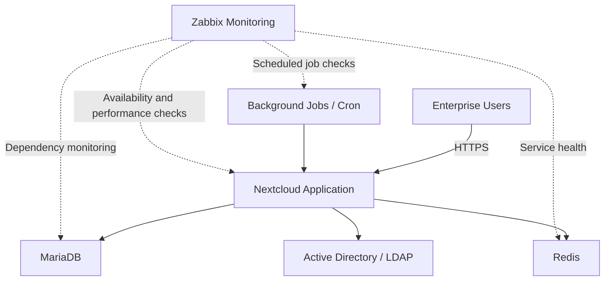
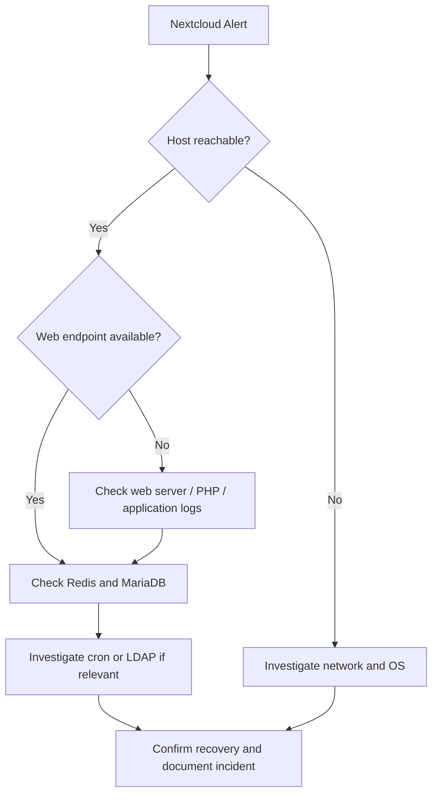

# Nextcloud — Service Monitoring Configuration

## 1. Objective

This case study documents a layered monitoring approach for an enterprise Nextcloud environment integrated with Active Directory.

The objective is to detect service outages, identify infrastructure bottlenecks, and investigate application dependencies.

The design draws on hands-on Nextcloud administration and infrastructure monitoring experience.

All public configuration examples are illustrative and require lab validation.

## 2. Service Architecture

This is a logical architecture, not a production network diagram.

## 3. Monitoring Layers

| Layer | Monitoring Requirement |
|---|---|
| Network | Host reachability and latency |
| Web | HTTPS availability and response time |
| Operating system | CPU, memory, disk and network traffic |
| Database | MariaDB availability |
| Cache | Redis service health |
| Background processing | Cron execution and job freshness |
| Authentication | AD/LDAP connectivity and login availability |
| Application | Nextcloud service status and logs |

These are target monitoring capabilities. They should not all be interpreted as previously implemented Zabbix checks.

## 4. Example Monitoring Items

### Host Availability

Type: Simple check

Key:

`icmpping`

Suggested interval: 1m

### HTTPS Availability

Example Zabbix web scenario:

- Scenario name: `Nextcloud HTTPS Availability`
- Step name: `Nextcloud Home`
- URL: `https://nextcloud.example.com/`
- Interval: 1m

The URL is illustrative.

For an unauthenticated endpoint, expected HTTP status codes must account for redirects and application behavior.

Generated Zabbix item:

`web.test.fail[Nextcloud HTTPS Availability]`

### Linux Resource Monitoring

Use the appropriate Zabbix Linux agent template to collect:

- CPU utilization
- Available memory
- Disk space and filesystem utilization
- Network traffic
- Host uptime
- Agent availability

### Redis Monitoring

Potential checks include:

- Redis service availability
- Process status
- Redis responsiveness
- Memory usage and connection health

The actual Redis check method must be selected and validated in the lab.

### MariaDB Monitoring

Potential checks include:

- Database service availability
- Active connections
- Database performance
- Storage availability
- Relevant error logs

Use a supported and tested monitoring method with appropriately restricted database credentials.

## 5. Background Job Monitoring

Nextcloud uses scheduled background jobs for maintenance and application tasks.

Potential monitoring signals:

- Cron service or timer availability
- Time since last successful background-job execution
- Application log errors related to background processing

Checking whether the cron service is running is not sufficient to prove that Nextcloud background jobs are succeeding.

The exact application-level health check will be developed during lab validation.

## 6. Authentication Monitoring

Enterprise Nextcloud environments may use Active Directory or LDAP for authentication.

Potential failure scenarios include:

- LDAP server unreachable
- Authentication failures
- Incorrect user mapping
- TLS or certificate problems
- Application-side LDAP configuration errors

Authentication health should be assessed using approved test procedures and without exposing credentials.

## 7. Example Trigger Expressions

Assume a lab host named `Nextcloud-Lab`.

### Host Unavailable

Severity: High

`max(/Nextcloud-Lab/icmpping,#3)=0`

### Web Scenario Failure

Severity: High

`last(/Nextcloud-Lab/web.test.fail[Nextcloud HTTPS Availability])<>0`

These are illustrative trigger expressions. Item availability and scenario configuration must be verified first.

## 8. Incident Investigation Workflow

## 9. Operational Considerations

- Separate host availability from application availability.
- Review Redis and database dependencies during incidents.
- Treat successful HTTP responses as only one health indicator.
- Monitor filesystem capacity and application storage requirements.
- Protect administrative and monitoring credentials.
- Avoid exposing internal LDAP details.
- Apply monitoring intervals appropriate to the service.
- Record confirmed root causes and corrective actions.

## 10. Implementation & Validation Status

| Area | Status |
|---|---|
| Nextcloud administration | Hands-on operational experience |
| Active Directory integration | Hands-on operational experience |
| Redis and cron configuration | Hands-on operational experience |
| Multi-layer monitoring design | Documented |
| Reproducible lab configuration | Pending |
| Exportable Zabbix template | Pending |
| Failure simulation and screenshots | Pending |

## 11. Future Lab Tasks

- [ ] Deploy an isolated Nextcloud test environment
- [ ] Configure a Nextcloud HTTPS web scenario
- [ ] Monitor Linux server resources
- [ ] Validate Redis and MariaDB monitoring
- [ ] Implement cron freshness monitoring
- [ ] Test simulated dependency failures
- [ ] Capture sanitized monitoring evidence
- [ ] Export a validated monitoring configuration

## 12. Lessons Learned

Reliable Nextcloud operations depend on more than web availability.

Database health, Redis caching, background processing, filesystem capacity and authentication services all contribute to application reliability.

Layered monitoring makes it easier to identify which dependency requires investigation.
