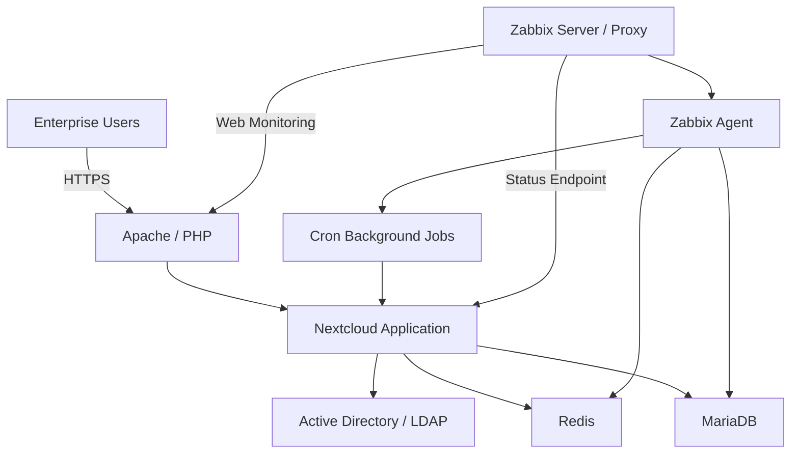
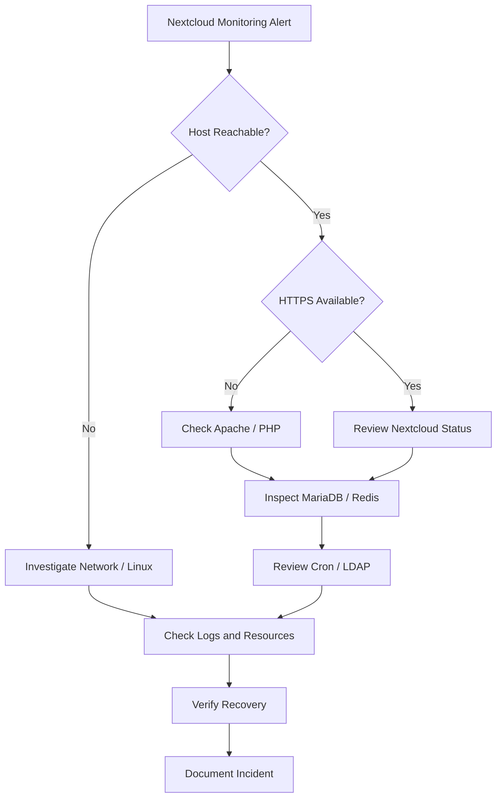

# Nextcloud — Zabbix Monitoring Configuration

## 1. Overview

This document presents a layered Zabbix monitoring configuration for a self-hosted Nextcloud environment integrated with Active Directory.

The monitoring design addresses application availability, Linux infrastructure, Apache/PHP, MariaDB, Redis, background jobs, and authentication dependencies.

It combines operational knowledge from Nextcloud administration with reusable Zabbix monitoring examples.

## 2. Technology Stack

| Component | Technology |
|---|---|
| Application | Nextcloud |
| Operating System | Linux |
| Web Server | Apache |
| Application Runtime | PHP |
| Database | MariaDB |
| Caching and File Locking | Redis |
| Background Processing | Cron |
| Identity Integration | Active Directory / LDAP |
| Monitoring | Zabbix 7.4 |

## 3. Logical Architecture



This diagram represents application dependencies and possible monitoring collection paths.

## 4. Monitoring Coverage

| Layer | Monitoring Signal | Collection Method |
|---|---|---|
| Network | Host reachability | ICMP |
| Web | HTTPS availability | Zabbix Web Scenario |
| Web | Response time | Zabbix Web Scenario |
| Application | Nextcloud status | HTTP Agent |
| Linux | CPU, memory, storage | Zabbix Agent |
| Apache | Service availability | Zabbix Agent |
| Database | MariaDB health | Agent / Database Monitoring |
| Redis | Process and connectivity | Agent / Redis Monitoring |
| Background Jobs | Execution freshness | Custom Check |
| Authentication | LDAP connectivity | Service / Application Checks |
| Security | TLS expiration | Certificate Monitoring |

The table defines monitoring methods for the proposed configuration. Individual checks can be selected according to operational requirements.

## 5. Host Availability Monitoring

### ICMP Availability

Item type: Simple check

Key:

```text
icmpping
```

Example update interval: `1m`

Additional metrics:

```text
icmppingloss
icmppingsec
```

These metrics provide host availability, packet loss, and response-time information.

### Host Unavailable Trigger

Example Zabbix host: `Nextcloud-Monitoring`

Severity: High

```text
max(/Nextcloud-Monitoring/icmpping,#3)=0
```

The trigger detects three consecutive unsuccessful reachability checks.

## 6. HTTPS Availability Monitoring

Zabbix Web Monitoring can check the user-facing Nextcloud endpoint.

### Web Scenario

| Parameter | Example |
|---|---|
| Scenario | Nextcloud HTTPS Availability |
| Step | Nextcloud Home |
| URL | https://nextcloud.example.com/ |
| Interval | 1m |
| Timeout | 15s |
| Authentication | According to endpoint requirements |

The example address is illustrative.

Expected HTTP response codes must account for redirects and the authentication behavior of the chosen endpoint.

### Generated Items

Web scenario failure:

```text
web.test.fail[Nextcloud HTTPS Availability]
```

Response time:

```text
web.test.time[Nextcloud HTTPS Availability,Nextcloud Home,resp]
```

HTTP response code:

```text
web.test.rspcode[Nextcloud HTTPS Availability,Nextcloud Home]
```

### Web Scenario Failure Trigger

Severity: High

```text
last(/Nextcloud-Monitoring/web.test.fail[Nextcloud HTTPS Availability])<>0
```

This trigger detects a failed web scenario step.

## 7. Nextcloud Application Status

Nextcloud exposes application status information through:

```text
https://nextcloud.example.com/status.php
```

An HTTP Agent item can retrieve the status response.

Relevant information includes:

- Installation state
- Maintenance mode
- Application version
- Update requirement

A monitoring configuration can use JSON preprocessing to extract individual fields from the response.

Example JSONPath expressions:

```text
$.installed
$.maintenance
$.needsDbUpgrade
$.version
```

Application status monitoring complements HTTPS availability checks.

## 8. Linux Infrastructure Monitoring

Use an appropriate Zabbix Linux Agent template.

Recommended metrics:

- CPU utilization
- Available memory
- Filesystem usage
- Disk I/O
- Network traffic
- Host uptime
- Agent availability

### Storage Monitoring

Storage utilization is particularly important for file-sharing platforms.

Monitor:

- Root filesystem utilization
- Application data storage
- Database storage
- Available disk capacity
- Storage performance trends

Alert thresholds should account for normal growth and available capacity.

## 9. Apache and PHP Monitoring

Monitor the web and application runtime components.

### Apache

Monitoring areas:

- Service availability
- HTTP/HTTPS response time
- CPU and memory utilization
- Application-related errors

Example Linux service check:

```bash
systemctl status apache2
```

### PHP

Monitoring depends on the PHP execution model.

For PHP-FPM deployments, the relevant PHP-FPM service and resource utilization can be monitored.

Application-level error monitoring should use appropriate log collection and access controls.

## 10. MariaDB Monitoring

MariaDB supports Nextcloud's application database.

Recommended monitoring areas:

- Database service availability
- Database connectivity
- Active connections
- CPU and memory utilization
- Storage capacity
- Database performance
- Relevant database errors

Example service investigation:

```bash
systemctl status mariadb
```

A running database service does not necessarily guarantee successful application database connectivity.

Database-specific checks should use appropriately restricted monitoring credentials.

## 11. Redis Monitoring

Redis supports caching and transactional file locking in many Nextcloud deployments.

Monitoring areas:

- Redis process availability
- Redis responsiveness
- Memory utilization
- Connection health
- Relevant service errors

Example service investigation:

```bash
systemctl status redis-server
```

Depending on the deployment, Redis may communicate through a Unix socket rather than TCP.

Monitoring configuration should reflect the actual Redis connection method.

## 12. Background Job Monitoring

Nextcloud relies on scheduled background tasks for application maintenance and asynchronous processing.

Monitoring considerations:

- Cron scheduling
- Last successful background job execution
- Application errors associated with background processing
- Job execution delays

A successful cron service check alone does not confirm that Nextcloud background tasks are executing correctly.

Application-level execution freshness provides a more meaningful monitoring signal.

## 13. Active Directory / LDAP Monitoring

Nextcloud can integrate with Active Directory through LDAP.

Relevant monitoring areas:

- Directory server reachability
- LDAP connection availability
- Authentication-related application errors
- TLS certificate validity
- Directory service dependencies

Authentication failures may result from network connectivity, directory services, credentials, certificates, or application-side configuration.

Monitoring should avoid exposing user credentials or confidential directory information.

## 14. TLS Certificate Monitoring

Certificate monitoring supports proactive renewal and service availability.

Recommended checks:

- Certificate expiration date
- Days remaining before expiration
- HTTPS connection failures
- Certificate-related application errors

Warning thresholds should align with certificate renewal procedures.

## 15. Operational Alert Scenarios

| Alert | Investigation |
|---|---|
| Host unavailable | Network, Linux, virtualization |
| HTTPS unavailable | Apache, PHP, Nextcloud |
| Elevated response time | Server resources, database, application |
| Maintenance mode active | Application state |
| MariaDB unavailable | Database service and connectivity |
| Redis unavailable | Cache and file locking |
| Disk capacity warning | Storage capacity |
| Background jobs delayed | Cron and application processing |
| LDAP connectivity failure | Directory service and network |
| TLS certificate expiring | Certificate renewal |

## 16. Incident Investigation Workflow



### Investigation Procedure

1. Review the Zabbix monitoring event.
2. Verify host connectivity.
3. Check HTTPS availability and response time.
4. Review the Nextcloud status endpoint.
5. Inspect Apache and PHP services.
6. Verify MariaDB availability.
7. Review Redis connectivity.
8. Check background job execution.
9. Investigate LDAP dependencies where relevant.
10. Review Linux resources and application logs.
11. Confirm service recovery.
12. Document the incident and corrective action.

## 17. Monitoring Design Considerations

- Monitor application availability separately from host availability.
- Correlate web response time with database and infrastructure metrics.
- Monitor supporting services and application dependencies.
- Choose monitoring methods appropriate to the deployment.
- Use meaningful alert thresholds.
- Protect monitoring credentials.
- Restrict access to monitoring interfaces.
- Document incident investigation procedures.

## 18. Operational Verification Checklist

### Application Monitoring

- [ ] Verify HTTPS availability
- [ ] Review HTTP response codes
- [ ] Confirm Nextcloud status endpoint checks
- [ ] Review application response time

### Infrastructure

- [ ] Verify Linux Agent availability
- [ ] Review CPU and memory monitoring
- [ ] Check filesystem utilization
- [ ] Review network metrics

### Dependencies

- [ ] Review Apache and PHP services
- [ ] Check MariaDB availability
- [ ] Verify Redis service health
- [ ] Inspect background job monitoring
- [ ] Review LDAP connectivity where applicable

### Alerting

- [ ] Review availability triggers
- [ ] Confirm notification policies
- [ ] Review trigger severity levels
- [ ] Check incident escalation procedures

## 19. Security Considerations

- Protect application and monitoring credentials.
- Apply least-privilege access.
- Use secure communication.
- Avoid publishing internal infrastructure identifiers.
- Exclude sensitive application and directory logs from public repositories.
- Use dedicated monitoring accounts where appropriate.

## 20. Related Documentation

- [Nextcloud Service Monitoring](nextcloud-service-monitoring.md)
- [Monitoring Architecture](architecture.md)
- [Monitoring Dashboards and Alerting](monitoring-dashboards-alerting.md)
- [Incident Response Runbooks](incident-response-runbooks.md)

## 21. References

- [Nextcloud Administration Documentation](https://docs.nextcloud.com/server/latest/admin_manual/)
- [Zabbix Documentation](https://www.zabbix.com/documentation/current/)
- [Zabbix Web Monitoring](https://www.zabbix.com/documentation/current/en/manual/web_monitoring)
