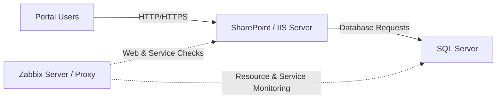
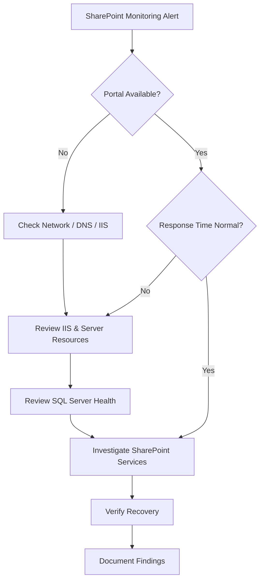

# SharePoint Portal — Enterprise Application Monitoring

## 1. Overview

This case study documents monitoring practices for an internal Microsoft SharePoint portal using Zabbix.

The monitoring approach focuses on web availability, IIS services, Windows Server resources, SQL Server dependencies, response-time analysis, and application troubleshooting.

The objective is to provide visibility beyond basic virtual machine availability and support the investigation of application performance issues.

The documentation is based on enterprise monitoring experience. Infrastructure identifiers and sensitive configuration details are anonymized.

## 2. Application Architecture

The SharePoint environment consists of two virtual machines:

| Component | Technology | Role |
|---|---|---|
| Application Server | Windows Server / IIS / SharePoint | Portal application and web services |
| Database Server | Microsoft SQL Server | Application database services |
| Monitoring Platform | Zabbix | Availability and performance monitoring |

### Logical Architecture



The diagram represents the logical relationship between the portal, database server, and monitoring platform.

## 3. Monitoring Objectives

- Monitor SharePoint portal availability
- Track HTTP/HTTPS response times
- Detect IIS service interruptions
- Monitor Windows Server resource utilization
- Monitor SQL Server availability
- Identify application and database dependencies
- Support performance troubleshooting
- Generate operational alerts for service failures

## 4. Monitoring Coverage

### 4.1 SharePoint Web Availability

Zabbix web scenarios provide visibility into:

- HTTP/HTTPS accessibility
- Expected response codes
- Response time
- Web scenario failures
- Application availability trends

The monitoring configuration includes a web scenario for the internal SharePoint portal.

### 4.2 Authentication Monitoring

The web scenario uses NTLM authentication to access the protected portal endpoint.

Authentication credentials are managed through protected monitoring configuration and secret macros.

Operational considerations include:

- Authentication permissions
- Credential protection
- Expected HTTP response codes
- Session and redirect behavior
- Monitoring account access

### 4.3 IIS Monitoring

IIS service monitoring supports detection of web service interruptions.

Monitoring areas include:

- IIS service availability
- Related Windows services
- Server resource utilization
- Application availability
- Web response time

Additional IIS performance indicators can help investigate resource pressure and application slowdowns.

### 4.4 SQL Server Monitoring

SQL Server monitoring provides visibility into the database layer supporting SharePoint.

Monitoring coverage includes:

- Windows Server resources
- SQL Server-related services
- SQL process availability
- Service discovery
- SQL monitoring items

Database-specific performance indicators can complement basic availability and resource checks.

## 5. Monitoring Architecture by Layer

| Layer | Monitoring Signal | Purpose |
|---|---|---|
| Network | Host reachability | Detect connectivity failures |
| Web | HTTP/HTTPS availability | Detect portal access failures |
| Application | Response time | Identify degraded user-facing performance |
| IIS | Service availability | Detect web service interruptions |
| Operating System | CPU, memory, disk, network | Investigate resource constraints |
| SQL Server | Service and process status | Identify database availability issues |
| Database Performance | Connections, waits, I/O latency | Support deeper root-cause analysis |

The deeper database performance indicators represent an extended monitoring scope rather than a claim that every metric was configured in the original environment.

## 6. SharePoint Web Scenario

A Zabbix web scenario can monitor the portal endpoint.

Example configuration:

| Parameter | Example |
|---|---|
| Scenario | SharePoint Portal Availability |
| Step | Portal Home |
| URL | https://sharepoint.example.com/ |
| Authentication | NTLM |
| Expected HTTP Code | 200 |
| Update Interval | 1m |

The URL and scenario names are illustrative.

Authentication and response validation should match the behavior of the monitored application.

### Generated Monitoring Metrics

Zabbix web scenarios can provide:

- Failed step number
- Response time
- HTTP response code

Example item keys:

```text
web.test.fail[SharePoint Portal Availability]
```

```text
web.test.time[SharePoint Portal Availability,Portal Home,resp]
```

```text
web.test.rspcode[SharePoint Portal Availability,Portal Home]
```

## 7. Operational Monitoring Observations

The SharePoint monitoring work included:

- Portal web availability checks
- HTTP response-time measurements
- NTLM-authenticated web scenario configuration
- IIS service availability alerts
- High-severity portal availability alerts
- SQL Server-related service monitoring
- Windows Server resource monitoring

During one observed monitoring check, the portal returned HTTP status `200` with a successful web scenario step.

The measured response time was approximately **755 milliseconds** for that observation.

This measurement represents an individual monitoring sample rather than a sustained performance baseline or service-level target.

## 8. Performance Monitoring Considerations

### IIS Application Performance

Additional performance indicators include:

- IIS application pool state
- IIS worker process (`w3wp`) resource utilization
- HTTP request queues
- ASP.NET request processing
- Application response time

### SharePoint Services

Relevant application-level indicators include:

- SharePoint Timer Service
- Search and crawl services
- Application service availability
- SharePoint ULS critical events

### SQL Server Performance

Database investigation may include:

- SQL batch requests
- User connections
- Blocked sessions
- Wait statistics
- Database I/O latency
- TempDB performance

These indicators support deeper troubleshooting when basic availability and operating system metrics are insufficient.

## 9. Application Troubleshooting Workflow



### Investigation Procedure

1. Review the Zabbix event and affected monitoring item.
2. Check portal HTTP/HTTPS availability.
3. Verify authentication and expected response codes.
4. Review portal response-time trends.
5. Check IIS service status.
6. Inspect Windows Server CPU, memory, disk and network performance.
7. Review SQL Server service availability.
8. Investigate database resource pressure where relevant.
9. Review SharePoint-specific services and application logs.
10. Verify service recovery and document the incident.

## 10. Alerting Scenarios

| Alert | Investigation Area |
|---|---|
| Portal unavailable | Network, DNS, TLS, IIS, application services |
| IIS service stopped | Windows service status and system logs |
| Elevated response time | IIS, application server, SQL Server |
| High CPU utilization | Application and operating system processes |
| Low available memory | Windows Server and application processes |
| Disk capacity warning | Server storage and database volumes |
| SQL Server service unavailable | Database services and connectivity |

Alert thresholds should reflect operational requirements and observed system performance.

## 11. Monitoring Design Considerations

### Application Availability

A reachable virtual machine does not guarantee that the SharePoint portal is accessible.

Application-level monitoring should complement host and service checks.

### Authentication

Authenticated web scenarios provide a more representative application access check when the portal requires user authentication.

Monitoring accounts should have appropriate permissions and protected credentials.

### Application Dependencies

SharePoint availability depends on multiple infrastructure and application components.

Monitoring should consider relationships between IIS, SharePoint services, Windows Server, SQL Server, and network connectivity.

### Response Time

Performance analysis should use historical monitoring data rather than relying on isolated measurements.

### Root-Cause Investigation

Application response time, resource utilization, service availability, and database performance should be analyzed together.

## 12. Operational Verification Checklist

### Web Monitoring

- [ ] Verify the SharePoint endpoint
- [ ] Confirm expected HTTP response codes
- [ ] Review authentication configuration
- [ ] Check web scenario availability
- [ ] Review response-time metrics

### IIS Monitoring

- [ ] Verify IIS service monitoring
- [ ] Review application server resources
- [ ] Inspect relevant Windows events

### SQL Server Monitoring

- [ ] Verify SQL Server service availability
- [ ] Review database server resources
- [ ] Inspect database-related monitoring items

### Alerting

- [ ] Review portal availability triggers
- [ ] Verify IIS service alerts
- [ ] Review response-time thresholds
- [ ] Confirm notification and escalation rules

## 13. Security Considerations

- Protect monitoring credentials and secret macros.
- Restrict access to monitoring configuration.
- Apply least-privilege permissions to monitoring accounts.
- Use HTTPS for application endpoint monitoring.
- Protect monitoring communication.
- Avoid exposing internal server names, IP addresses, or authentication details.
- Exclude production logs and sensitive data from public documentation.

## 14. Related Documentation

- [SharePoint Zabbix Configuration](sharepoint-zabbix-configuration.md)
- [Monitoring Architecture](architecture.md)
- [Monitoring Dashboards and Alerting](monitoring-dashboards-alerting.md)
- [Incident Response Runbooks](incident-response-runbooks.md)

## 15. References

- [Zabbix Documentation](https://www.zabbix.com/documentation/current/)
- [Zabbix Web Monitoring](https://www.zabbix.com/documentation/current/en/manual/web_monitoring)
