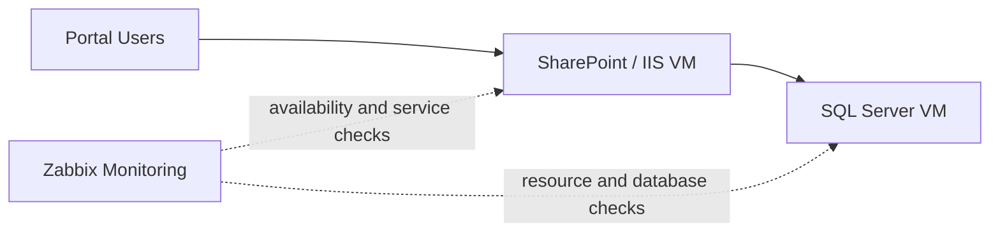

# SharePoint Portal — IIS, Web Availability and SQL Monitoring

**Category:** Enterprise application monitoring · Microsoft stack · Zabbix  
**Status:** Case study of implemented monitoring and documented expansion backlog; lab verification pending.

## Scenario and architecture

An internal SharePoint portal spans two virtual machines:

- **Portal application VM:** Windows Server, IIS, SharePoint web application
- **Database VM:** Microsoft SQL Server

A noticeable slowdown in the user-facing portal motivated monitoring beyond basic VM uptime. The goal was to distinguish web availability issues from application-pool, server-resource and database bottlenecks.

All names in this diagram are generic and do not identify any production environment.

## Implemented monitoring

| Layer | Evidence from implementation | Status |
|---|---|---|
| Portal HTTP(S) | Zabbix web scenario for site availability and response time | Implemented |
| Authentication | Web scenario configured for NTLM using secret macros | Implemented |
| IIS availability | IIS service-state alert | Implemented |
| Portal health | High-severity website-down alert | Implemented |
| SQL server | Basic Windows/SQL process and resource monitoring; custom SQL-focused items created | Implemented in part |
| SQL services | Discovery of SQL Server-related Windows services | Implemented |

During an observed check, the portal web scenario returned HTTP `200` with a successful step; a measured response time was approximately **755 ms at that moment**. This is a single observation, **not** an SLA or a sustained performance result.

## Expansion plan — not presented as completed

The following were proposed for deeper root-cause monitoring and should be validated in the lab before being marked as implemented:

- IIS application-pool state, worker process (`w3wp`) resource use and request queues
- ASP.NET request queues and waiting requests
- SharePoint Timer Service, search/crawl health and ULS critical events
- SQL batch requests, user connections, blocked sessions, wait statistics and database/TempDB latency
- Correlation across application response time, IIS saturation and SQL resource pressure

## Diagnostic decision path

1. **Web scenario failed?** Check DNS, network route, TLS and IIS service state.
2. **HTTP returns 200 but is slow?** Compare portal response-time trend with IIS worker resource use and server CPU/memory.
3. **Application resources look normal?** Review SQL server health, connections and query-related performance indicators.
4. **Issue affects only a feature?** Investigate SharePoint-specific services and application events with the responsible team.
5. Record the result and establish an evidence-based alert threshold.

## Lab artifacts to add later

- [ ] Sanitized SharePoint-style test architecture and monitoring screenshots
- [ ] Reusable IIS web scenario / template export
- [ ] Validated SQL Server monitoring example
- [ ] Redacted troubleshooting runbook and alert dashboard

## Security and confidentiality

No domain names, project paths, client identifiers, internal IPs, authentication secrets, or production logs are included.
