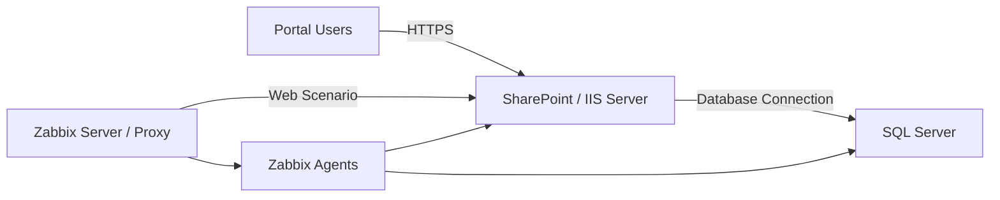
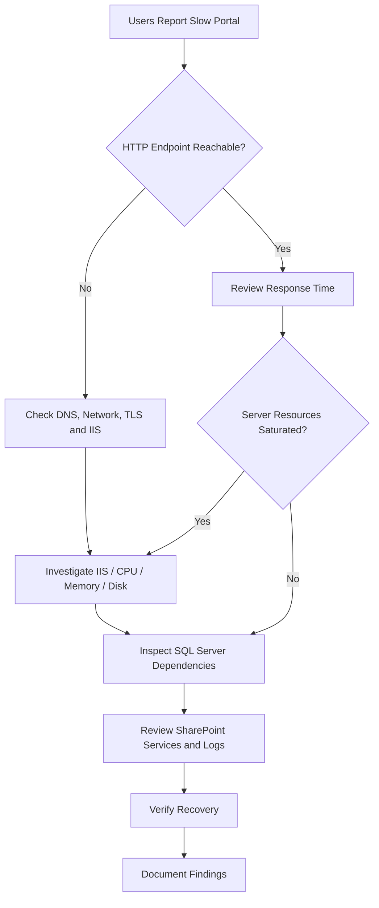

# SharePoint Portal — Zabbix Monitoring Configuration

## 1. Overview

This document describes a layered Zabbix monitoring configuration for an enterprise Microsoft SharePoint portal hosted on Windows Server and IIS, with a separate Microsoft SQL Server backend.

The monitoring approach focuses on web availability, authenticated access, IIS service health, operating system resources, and database dependencies.

The configuration is based on enterprise application monitoring experience and includes reusable technical examples.

## 2. Monitoring Architecture



The diagram illustrates logical monitoring relationships using anonymized infrastructure components.

## 3. Monitoring Layers

| Layer | Monitoring Scope |
|---|---|
| Network | Host reachability |
| Web | HTTPS availability and response time |
| Authentication | NTLM-aware web scenario |
| IIS | Windows service availability |
| Operating System | CPU, memory, disk, network |
| SQL Server | Service discovery and process monitoring |
| Database Performance | Connections, waits, blocking, latency |
| SharePoint Services | Timer jobs, search services, application logs |

Web availability, NTLM authentication, IIS service monitoring, and basic SQL-related monitoring were part of the operational monitoring work.

Database performance and SharePoint-specific indicators provide additional options for deeper troubleshooting.

## 4. Web Scenario Configuration

### Scenario Name

`SharePoint Portal Availability`

### Example Configuration

| Parameter | Value |
|---|---|
| Step name | Portal Home |
| URL | https://sharepoint.example.com/ |
| Update interval | 1m |
| Timeout | 15s |
| Authentication | NTLM |
| Expected HTTP status | 200 |

The endpoint and names are illustrative.

The expected response code and authentication settings should match the monitored portal.

### Authentication

For an NTLM-protected portal:

- Use a dedicated monitoring account.
- Apply minimum required permissions.
- Protect authentication credentials.
- Configure the appropriate authentication method in the web scenario.
- Review redirects and expected responses.

Sensitive credentials must not be stored in public configuration examples.

### Generated Web Scenario Items

Failed step:

```text
web.test.fail[SharePoint Portal Availability]
```

Response time:

```text
web.test.time[SharePoint Portal Availability,Portal Home,resp]
```

HTTP response code:

```text
web.test.rspcode[SharePoint Portal Availability,Portal Home]
```

These items are generated by the configured Zabbix web scenario.

## 5. Trigger Expressions

The following examples use a Zabbix host named `SharePoint-Monitoring`.

### 5.1 Portal Unavailable

Severity: High

```text
last(/SharePoint-Monitoring/web.test.fail[SharePoint Portal Availability])<>0
```

This trigger detects a failed web scenario step.

### 5.2 Elevated Response Time

Severity: Warning

```text
avg(/SharePoint-Monitoring/web.test.time[SharePoint Portal Availability,Portal Home,resp],5m)>3
```

The example detects an average response time above three seconds over five minutes.

Response-time thresholds should be selected according to measured application performance and service requirements.

### 5.3 High CPU Utilization

An example CPU trigger, using a compatible Windows monitoring item:

```text
avg(/SharePoint-Monitoring/system.cpu.util,5m)>90
```

The item key must match the Windows monitoring template and agent configuration in use.

## 6. IIS Monitoring

IIS monitoring provides visibility into the web service layer supporting SharePoint.

### Service Availability

Monitor relevant Windows services to identify service interruptions.

The enterprise monitoring work included IIS-related service-state alerting.

### Application Performance

Additional IIS metrics can include:

- Application pool state
- IIS worker process (`w3wp.exe`) availability
- Worker process CPU utilization
- Worker process memory consumption
- HTTP request queues
- ASP.NET request processing
- Relevant Windows event logs

These metrics help distinguish basic service failures from application performance degradation.

## 7. SQL Server Monitoring

Microsoft SQL Server is a critical dependency of the SharePoint portal.

### Basic Monitoring

Monitoring areas include:

- Windows Server availability
- SQL Server-related Windows services
- SQL service discovery
- CPU and memory utilization
- Disk capacity
- SQL process health

### Database Performance Indicators

For more detailed investigation:

- Active user connections
- SQL batch requests
- Blocked sessions
- Database wait statistics
- Disk read and write latency
- TempDB utilization
- Query performance indicators

Database-specific checks should use appropriate permissions and collection methods.

## 8. Application Performance Investigation

### Scenario: SharePoint Portal Is Slow



### Investigation Procedure

1. Confirm the affected SharePoint URL.
2. Review Zabbix web scenario results.
3. Check response-time history.
4. Inspect IIS service availability.
5. Review application server CPU and memory.
6. Check disk and network performance.
7. Verify SQL Server service availability.
8. Investigate database performance indicators where relevant.
9. Review SharePoint application services and logs.
10. Verify recovery and document findings.

## 9. Operational Monitoring Observation

During an earlier monitoring check, the authenticated SharePoint web scenario returned HTTP status `200`.

An observed response time was approximately **755 ms**.

This value represents an individual monitoring observation and is not used as an application SLA or sustained performance baseline.

## 10. Alerting and Correlation

Recommended alerting scenarios include:

| Alert | Investigation Area |
|---|---|
| Portal unavailable | Network, DNS, TLS, IIS |
| Authentication failure | Monitoring account, permissions, NTLM |
| Elevated response time | IIS, server resources, SQL Server |
| IIS service stopped | Windows services and logs |
| High CPU utilization | Application and operating system processes |
| Low available memory | Server memory consumption |
| SQL Server unavailable | Database services and connectivity |
| Disk performance degradation | Storage performance and database activity |

Correlating multiple monitoring signals helps identify the most likely source of an application issue.

## 11. Operational Verification Checklist

### Web Monitoring

- [ ] Verify endpoint URL
- [ ] Review HTTP response code
- [ ] Verify NTLM authentication configuration
- [ ] Inspect web scenario results
- [ ] Review response-time metrics

### IIS Monitoring

- [ ] Confirm Windows service monitoring
- [ ] Review IIS-related service alerts
- [ ] Inspect application server resources
- [ ] Review application pool indicators where configured

### SQL Server Monitoring

- [ ] Verify SQL-related service discovery
- [ ] Check database server resource metrics
- [ ] Review SQL availability indicators
- [ ] Inspect database performance metrics where configured

### Alerting

- [ ] Review portal availability trigger
- [ ] Check response-time thresholds
- [ ] Verify IIS service alerts
- [ ] Review severity levels
- [ ] Confirm notification and escalation rules

## 12. Security Considerations

- Use dedicated monitoring accounts.
- Apply least-privilege access.
- Protect authentication credentials.
- Restrict access to Zabbix configuration.
- Use HTTPS for portal checks.
- Protect communication between monitoring components.
- Avoid exposing production hostnames or network details.
- Exclude sensitive logs and secrets from public repositories.

## 13. Related Documentation

- [SharePoint Portal Monitoring](sharepoint-portal-monitoring.md)
- [Monitoring Architecture](architecture.md)
- [Monitoring Dashboards and Alerting](monitoring-dashboards-alerting.md)
- [Incident Response Runbooks](incident-response-runbooks.md)

## 14. References

- [Zabbix Documentation](https://www.zabbix.com/documentation/current/)
- [Zabbix Web Monitoring](https://www.zabbix.com/documentation/current/en/manual/web_monitoring)
