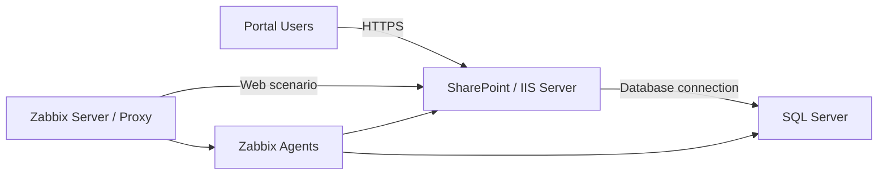
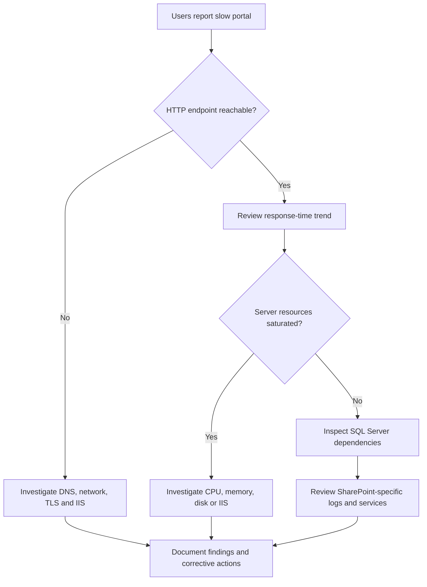

# SharePoint Portal — Zabbix Monitoring Configuration

## 1. Objective

This case study documents a layered monitoring approach for an enterprise SharePoint portal hosted on Windows Server and IIS, with a separate Microsoft SQL Server backend.

The objective is to distinguish between:

- Portal availability failures
- Authentication and web access issues
- IIS and application service problems
- Server resource bottlenecks
- SQL Server performance and availability issues

The design is based on enterprise monitoring work. Additional configuration examples are proposed for future lab validation.

## 2. Architecture

The diagram uses generic components and does not disclose production topology.

## 3. Monitoring Layers

| Layer | Monitoring Scope | Status |
|---|---|---|
| Web | HTTPS availability and response time | Previously implemented |
| Authentication | NTLM-aware web scenario | Previously implemented |
| IIS | Service availability alert | Previously implemented |
| Operating system | CPU, memory, disk and network health | Previously monitored |
| SQL Server | Basic process and resource monitoring | Partially implemented |
| SQL services | Windows service discovery | Previously implemented |
| SQL performance | Waits, blocking, latency, TempDB | Proposed expansion |
| SharePoint internals | Timer jobs, search and ULS errors | Proposed expansion |

## 4. Web Scenario Configuration

### Scenario Name

`SharePoint Portal Availability`

### Example Configuration

| Parameter | Example |
|---|---|
| URL | https://sharepoint.example.com/ |
| Interval | 1m |
| Timeout | 15s |
| Authentication | NTLM, where applicable |
| Expected HTTP status | 200, after confirming expected behavior |

The address is illustrative.

For authenticated checks, use a dedicated monitoring account with minimum required permissions.

Store authentication secrets securely. Do not place passwords or tokens in repository files.

### Generated Web Scenario Metrics

Example Zabbix item keys:

`web.test.fail[SharePoint Portal Availability]`

`web.test.time[SharePoint Portal Availability,Portal Home,resp]`

`web.test.rspcode[SharePoint Portal Availability,Portal Home]`

These metrics are generated by Zabbix web monitoring.

## 5. Example Trigger Expressions

Assume a lab host named `SharePoint-Lab`.

### Portal Unavailable

Severity: High

`last(/SharePoint-Lab/web.test.fail[SharePoint Portal Availability])<>0`

### Elevated Portal Response Time

Severity: Warning

`avg(/SharePoint-Lab/web.test.time[SharePoint Portal Availability,Portal Home,resp],5m)>3`

The three-second threshold is illustrative and must be adjusted after collecting baseline measurements.

### Server CPU Saturation

Use a validated Windows monitoring item from the applicable Zabbix template.

For example, if the corresponding item exists:

`avg(/SharePoint-Lab/system.cpu.util,5m)>90`

Confirm the supported item key and the normal workload baseline before using this trigger.

## 6. IIS Monitoring

IIS monitoring should distinguish between:

- IIS service availability
- Application pool availability
- Web response failures
- Worker process resource consumption
- Request queue growth

### Previously Implemented

An IIS-related service-state alert was configured in the monitored environment.

### Proposed Improvements

Future lab work should include:

- IIS application pool state
- Worker process (`w3wp.exe`) health
- Request queue length
- ASP.NET request errors
- Relevant Windows event log entries

Do not assume a successful HTTP request proves that every SharePoint application component is healthy.

## 7. SQL Server Monitoring

The SQL Server backend is a critical dependency of the portal.

### Basic Monitoring

- Windows server availability
- SQL Server-related service discovery
- CPU and memory consumption
- Disk utilization
- SQL-related process health

### Advanced Monitoring Backlog

The following metrics are planned for deeper diagnosis:

- SQL Server user connections
- Batch requests per second
- Blocked processes and sessions
- Database wait statistics
- Disk read/write latency
- TempDB utilization and contention
- Query performance indicators

These advanced metrics are not presented as fully validated production monitoring.

## 8. Performance Investigation

### Scenario: SharePoint Portal Is Slow

### Investigation Procedure

1. Confirm the affected URL and user-reported symptoms.
2. Review the Zabbix web scenario results.
3. Compare HTTP response-time trends.
4. Check IIS and related Windows services.
5. Examine CPU, memory, disk and network metrics.
6. Review SQL Server availability and resource utilization.
7. Investigate authentication or SharePoint-specific errors.
8. Record the confirmed root cause or remaining uncertainty.

## 9. Observed Monitoring Result

During an earlier monitoring check, the authenticated portal web scenario returned HTTP 200.

An observed response time was approximately 755 ms at that moment.

This was a single measurement, not a sustained performance benchmark or an SLA result.

## 10. Operational Considerations

- Apply appropriate permissions to monitoring accounts.
- Use encrypted HTTPS connections.
- Keep monitoring credentials out of version control.
- Avoid unnecessary repeated authenticated requests.
- Configure meaningful alert severities.
- Correlate IIS, web and SQL metrics during incidents.
- Validate performance thresholds against measured baselines.
- Separate implemented monitoring from planned enhancements.

## 11. Future Lab Validation

- [ ] Prepare an isolated IIS-based test environment
- [ ] Configure a Zabbix HTTPS web scenario
- [ ] Validate authenticated monitoring where applicable
- [ ] Test IIS service failure detection
- [ ] Monitor IIS application pool health
- [ ] Configure SQL Server availability checks
- [ ] Test portal response-time alerting
- [ ] Capture sanitized Zabbix screenshots
- [ ] Export and validate a reusable monitoring template

## 12. Key Takeaways

Enterprise portal monitoring requires visibility beyond basic host availability.

Correlating web response times, IIS health, Windows resource utilization and database dependencies provides a more structured approach to diagnosing service degradation.

All examples require verification in a dedicated lab before being considered production-ready.
