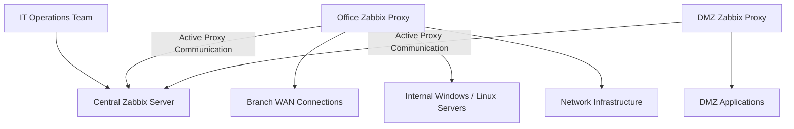

# Zabbix Proxy Deployment & Distributed Monitoring

## 1. Overview

This document describes the architecture, configuration, and operational considerations of distributed Zabbix monitoring in a segmented enterprise IT environment.

The monitoring platform supports infrastructure and service visibility across an organization with more than 1,000 users and 31 branch offices.

Zabbix Proxies extend monitoring coverage across network segments while maintaining centralized configuration, event processing, and alert management.

The technical approach is based on enterprise infrastructure monitoring experience.

Infrastructure identifiers and network information are anonymized.

## 2. Technology Stack

| Component | Technology |
|---|---|
| Central Monitoring | Zabbix 7.4 |
| Proxy Operating System | Debian 12 |
| Proxy Communication | Active Mode |
| Network Zones | Office and DMZ |
| Monitoring Protocols | Zabbix Agent, ICMP, HTTP/HTTPS |
| Central Database | PostgreSQL |
| Web Frontend | Nginx and PHP-FPM |

## 3. Distributed Monitoring Architecture



The diagram represents the logical monitoring architecture.

Network accessibility depends on firewall policies, routing, monitored host locations, and proxy assignments.

## 4. Zabbix Proxy Architecture

A Zabbix Proxy collects monitoring data from assigned hosts and forwards that data to the central Zabbix Server.

The proxy provides:

- Distributed monitoring data collection
- Monitoring across segmented networks
- Local buffering during communication interruptions
- Centralized configuration management
- Reduced need for direct cross-segment monitoring access
- Improved flexibility in host placement and monitoring architecture

The Zabbix Server remains responsible for central monitoring configuration, trigger processing, event generation, and notifications.

## 5. Proxy Deployment Approach

### Proxy Preparation

The deployment process includes:

1. Prepare a Debian Linux host.
2. Install a compatible Zabbix Proxy package.
3. Configure the proxy database.
4. Define a unique proxy hostname.
5. Configure connectivity to the central Zabbix Server.
6. Configure encrypted communication where required.
7. Start and enable the Zabbix Proxy service.
8. Register the proxy in the Zabbix frontend.
9. Assign monitored hosts to the proxy.
10. Verify data collection and forwarding.

### Office Proxy

The Office Proxy provides monitoring access to selected internal infrastructure resources.

Typical monitoring targets include:

- Windows Server systems
- Linux servers
- Network equipment
- Branch WAN connections
- Internal infrastructure services

The proxy must have the necessary network routes and permissions to reach its assigned monitoring targets and central server.

### DMZ Proxy

The DMZ Proxy provides distributed monitoring for services located in a segmented DMZ environment.

Typical monitoring targets include:

- Application servers
- HTTP/HTTPS services
- Server resource metrics
- Application processes
- Business-critical service endpoints

Communication between the DMZ and other network zones should follow defined firewall and security policies.

## 6. Active Proxy Communication

In active mode, the Zabbix Proxy initiates communication with the central Zabbix Server.

The central server provides the proxy configuration, while the proxy collects monitoring data from assigned targets and forwards the results.

### Example Configuration

```ini id="ax8buc"
# Zabbix Proxy configuration example

ProxyMode=0
Server=zabbix.example.test
Hostname=zabbix-proxy-dmz
```

The configuration uses an illustrative hostname.

The `Hostname` value must match the proxy identity configured on the central Zabbix Server.

The exact configuration parameters should be checked against the installed Zabbix version.

### Communication Considerations

- Active proxies initiate connections to the Zabbix Server.
- The central server must accept connections from authorized proxies.
- Proxy communication commonly uses TCP port 10051.
- Routing and firewall policies must permit the required traffic.
- Communication can be protected using supported TLS options.

## 7. Encrypted Proxy Communication

Zabbix supports encrypted communication between monitoring components.

A pre-shared key (PSK) configuration involves:

- A configured TLS PSK identity
- A matching PSK on both communicating endpoints
- Appropriate proxy encryption settings
- Protected PSK file permissions
- Consistent proxy identity configuration

Example configuration concepts:

```ini id="ix5cpp"
TLSConnect=psk
TLSPSKIdentity=proxy-dmz-identity
TLSPSKFile=/etc/zabbix/proxy.psk
```

The PSK file must contain a securely generated secret and should not be committed to source control.

The central server must be configured with the corresponding proxy encryption settings.

## 8. Monitoring Host Assignment

Each monitored host must be assigned to an appropriate collection point.

Host assignment considerations include:

- Network reachability
- Firewall segmentation
- Monitoring protocol
- Service location
- Proxy capacity
- Communication reliability

After assigning a host to a proxy, verify:

1. Host configuration synchronization.
2. Agent or service connectivity.
3. Item availability.
4. Monitoring data collection.
5. Arrival of values in Zabbix Latest data.

## 9. Operational Monitoring

Zabbix Proxy monitoring should include:

- Proxy service availability
- Proxy-to-server connectivity
- Configuration synchronization
- Data collection status
- Buffered monitoring data
- Proxy CPU and memory utilization
- Proxy storage capacity
- Monitoring queue and collection delays

These metrics help identify proxy performance issues and communication interruptions.

## 10. Troubleshooting

### Proxy Cannot Connect to the Central Server

Possible causes include:

- Incorrect server address
- Firewall restrictions
- Routing problems
- Proxy hostname mismatch
- Encryption configuration mismatch
- Zabbix Proxy service failure

Investigation:

```bash id="e0k3w0"
sudo systemctl status zabbix-proxy
```

Inspect service logs:

```bash id="6mv4s0"
sudo journalctl -u zabbix-proxy -n 100 --no-pager
```

Check DNS resolution:

```bash id="yd6s5s"
getent hosts zabbix.example.test
```

Check TCP connectivity:

```bash id="8q9iz5"
nc -vz zabbix.example.test 10051
```

A successful TCP connection confirms basic reachability, but does not guarantee successful proxy authentication or configuration synchronization.

### Proxy Is Connected but Data Is Missing

Check:

1. Host assignment to the correct proxy.
2. Proxy configuration synchronization.
3. Network connectivity to monitored hosts.
4. Zabbix Agent configuration.
5. Item support and collection errors.
6. Proxy logs.
7. Monitoring values in Latest data.

### Proxy Authentication or Encryption Failure

Review:

- Proxy registration name
- PSK identity
- PSK file contents and permissions
- Server-side encryption configuration
- Proxy log messages

Do not disable encryption as a permanent workaround for authentication failures.

### Monitoring Data Is Delayed

Review:

- Proxy resource utilization
- Available storage capacity
- Database performance
- Proxy connectivity
- Monitoring item volume
- Collection and upload intervals
- Proxy internal process utilization

## 11. Security Considerations

- Limit communication to required network paths.
- Apply least-privilege service permissions.
- Protect proxy configuration files.
- Protect TLS certificates and PSKs.
- Restrict administrative access.
- Use appropriate firewall rules.
- Monitor proxy availability.
- Avoid storing secrets in public repositories.
- Review network segmentation requirements.

## 12. Operational Verification Checklist

### Proxy Service

- [ ] Verify Zabbix Proxy service status
- [ ] Inspect startup and runtime logs
- [ ] Verify configured proxy identity
- [ ] Confirm central server address

### Network Connectivity

- [ ] Verify routing to the central server
- [ ] Verify TCP port 10051 connectivity
- [ ] Review required firewall permissions
- [ ] Confirm monitored target reachability

### Security

- [ ] Verify encryption configuration
- [ ] Confirm PSK identity consistency
- [ ] Review sensitive file permissions

### Monitoring Data

- [ ] Verify proxy registration
- [ ] Confirm host assignments
- [ ] Verify configuration synchronization
- [ ] Inspect item availability
- [ ] Confirm metrics in Latest data
- [ ] Review proxy performance metrics

## 13. Operational Lessons

Distributed monitoring requires more than installing monitoring software.

Reliable operation depends on:

- Correct network segmentation
- Firewall and routing configuration
- Consistent proxy identification
- Secure communication
- Monitoring target reachability
- Resource planning
- Structured troubleshooting

An organized proxy architecture helps extend monitoring coverage while preserving centralized operational visibility.

## 14. Related Documentation

- [Monitoring Architecture](architecture.md)
- [Branch WAN Monitoring](branch-wan-monitoring.md)
- [Monitoring Dashboards and Alerting](monitoring-dashboards-alerting.md)
- [Incident Response Runbooks](incident-response-runbooks.md)

## 15. References

- [Zabbix Documentation](https://www.zabbix.com/documentation/current/)
- [Zabbix Proxy Documentation](https://www.zabbix.com/documentation/current/en/manual/concepts/proxy)
- [Zabbix Encryption Documentation](https://www.zabbix.com/documentation/current/en/manual/encryption)
