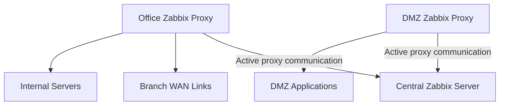

# Zabbix Proxy Deployment & Distributed Monitoring

## 1. Project Overview

This case study documents the deployment and operation of Zabbix proxies in a segmented enterprise IT environment.

The monitoring platform supports infrastructure and service visibility across a distributed organization with 1,000+ users and 31 branches.

The objective was to improve monitoring coverage across different network zones without requiring every monitored system to communicate directly with the central Zabbix server.

All infrastructure identifiers and network details are anonymized.

## 2. Technology Stack

| Component | Technology |
|---|---|
| Central monitoring | Zabbix 7.4 |
| Proxy operating system | Debian 12 |
| Proxy mode | Active |
| Network zones | Office and DMZ |
| Monitoring protocols | Zabbix Agent, ICMP, HTTP/HTTPS |

The central Zabbix platform uses PostgreSQL, Nginx, and PHP-FPM.

## 3. Architecture

The diagram is a simplified representation of the distributed monitoring design. Actual network access depends on firewall rules and host placement.

## 4. Deployment Approach

### Phase 1: Proxy Preparation

- Prepare dedicated Debian 12 hosts.
- Install compatible Zabbix proxy packages.
- Configure the proxy database.
- Define unique proxy names.
- Configure central server connectivity.
- Enable and start the proxy services.

### Phase 2: Office Proxy

The Office proxy provides monitoring coverage for systems reachable from the internal network.

Monitoring scenarios include:

- Windows and Linux servers
- Network equipment
- Branch WAN connections
- Internal infrastructure availability

### Phase 3: DMZ Proxy

The DMZ proxy extends monitoring to services within the DMZ.

The deployment requires controlled network communication and appropriate firewall permissions.

Monitoring scenarios include:

- Application and service availability
- HTTP/HTTPS endpoint checks
- Server resource monitoring
- Relevant application processes and services

## 5. Active Proxy Communication

Active proxies establish communication with the central Zabbix server.

Key configuration concepts:

- `ProxyMode=0`
- `Server=<central-zabbix-server>`
- `Hostname=<registered-proxy-name>`

The configured hostname must match the proxy name registered on the Zabbix server.

These are illustrative configuration parameters, not a production configuration export.

## 6. Network and Security Considerations

- Allow only required communication between proxies and the central server.
- Restrict monitoring access to authorized targets.
- Review firewall rules between network segments.
- Use encrypted proxy communication where configured and supported.
- Protect credentials and configuration files.
- Monitor proxy availability and performance.

## 7. Operational Challenges

### Proxy Connectivity

Proxy communication can fail when the required network path or firewall permission is unavailable.

Troubleshooting approach:

1. Verify network reachability.
2. Check the Zabbix proxy service.
3. Review proxy logs.
4. Validate server address and proxy hostname.
5. Review firewall rules.
6. Confirm the proxy's status in the Zabbix frontend.

### Monitoring Data Collection

If a proxy is reachable but monitoring data is unavailable:

1. Verify host-to-proxy assignment.
2. Check connectivity to the monitored target.
3. Review item configuration and supported checks.
4. Check proxy logs and item errors.
5. Confirm data arrival in Latest data.

## 8. Operational Outcome

The Office and DMZ proxy deployments were brought into active operation after resolving configuration and network access issues.

This distributed design provides a foundation for monitoring systems located in separate network zones.

No numerical availability or performance improvements are claimed without supporting measurements.

## 9. Future Lab Validation

- [ ] Reproduce the proxy architecture in an isolated lab
- [ ] Document package installation and configuration
- [ ] Validate active proxy communication
- [ ] Test firewall and connectivity failure scenarios
- [ ] Test collection of agent and ICMP metrics
- [ ] Add sanitized configuration examples
- [ ] Add screenshots and troubleshooting evidence

## 10. Lessons Learned

Distributed monitoring requires more than installing monitoring software.

Successful deployment depends on network segmentation, access permissions, configuration consistency, monitoring target reachability, and structured troubleshooting.

Clear documentation helps make the architecture maintainable and repeatable.
